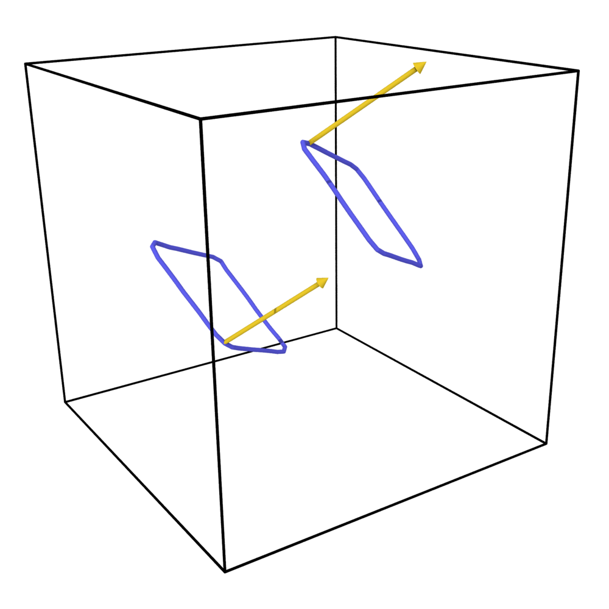
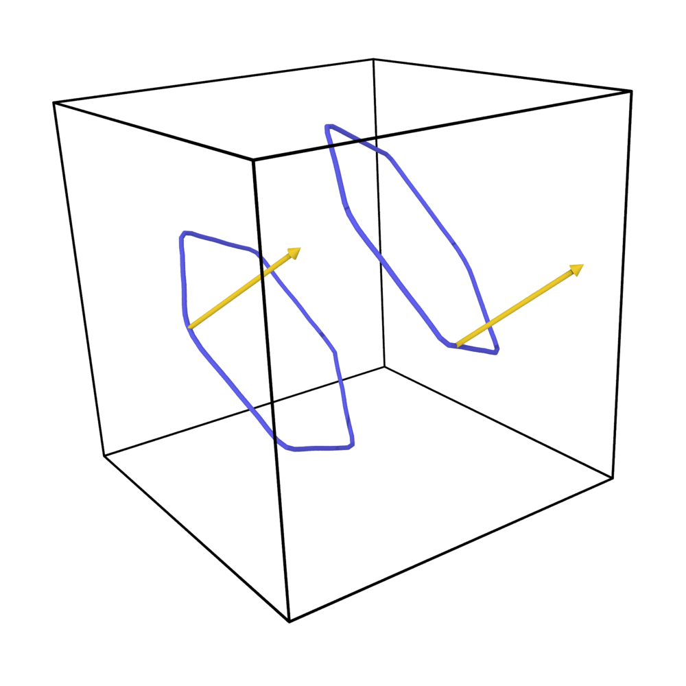

# Input generators

The scripts in `Examples/generators/` write DISCO YAML inputs. Each generated `<name>.yaml` comes with a
**ground-truth sidecar** `<name>.json` that records what the sample should contain. Compare it with
the output of a dislocation analysis (DXA, DANCE, …) to validate that analysis.

```
Examples/generators/
  exec_input.py                        shared helpers (no command line)
  make_single_loop.py                  one glissile loop: circular / square / rectangular / ⟨111⟩ parallelogram
  make_quadrupole.py                   4 loops on two {110} planes: junction | annihilation
  make_prismatic_dipole.py             rhombic prismatic dipole from 4 shear loops
  make_hexagonal_prismatic_dipole.py   hexagonal prismatic dipole from 6 shear loops
  make_prismatic_dipoles.py            N prismatic dipoles (rhombic or hexagonal) at random positions
```

## Conventions

- Python 3 with numpy. The scripts can be run from any directory; `--help` lists every option.
- **Slip systems** are read from `Parameters/BCC.txt` (`--bcc` to use another file).
  `--system N` is the position 1..48 in that file: 12 systems per ½⟨111⟩ Burgers vector, each
  listing 3 {110}, 3 {112} and 6 {123} planes. The same file and numbering are used by the DANCE
  analysis code, so `expected_slip_system` in the sidecar can be compared directly with what DANCE reports.
- **Lengths** are in Å, as in the input file. `--units a0` switches every length option to units of a0.
- b = (a0/2) m. Rectangles have their sides along m (screw, `Half_m`) and along p = m × n (edge, `Half_p`).
- DISCO moves every loop centre along n onto the nearest mid-plane between atomic planes
  (see [Input file](input.md#loop-centre-and-cut-plane)). The scripts reproduce that rule in Python.
  The quadrupole and prismatic scripts put their planes on mid-planes directly, so nothing moves.
- **Box:** by default, the smallest even cube that leaves 12 a0 between the loops and the box faces
  (`--cells` to override).
- **Output format:** `xyz` by default (`--format lammps|both|none`).

## `make_single_loop.py`: one glissile loop

```bash
python3 make_single_loop.py --system 1                          # circle R = 8 a0 on BCC.txt system 1
python3 make_single_loop.py --shape square --system 4           # {112}
python3 make_single_loop.py --shape rectangular --system 7 --corner-radius 13.2
python3 make_single_loop.py --family all --outdir db/           # all 48 systems
python3 make_single_loop.py --family 123 --units a0 --radius 10 --outdir db/
python3 make_single_loop.py --m 1 -1 1 --n 1 1 0 -o my_loop.yaml
```

The default sizes are:

- circle: R = 8 a0;
- square: half-side 8 a0;
- rectangle: `Half_m` = 16 a0, `Half_p` = 8 a0.

The default loopon step is 0.4 a0. Files are named like `circ_f112_sys04.yaml`
(`rect_rounded_…` when `--corner-radius` > 0).

**⟨111⟩ parallelogram.** `--shape parallelogram` writes `Shape: parallelogram` with `Dir_1` = b
and `Dir_2` = the other ⟨111⟩ of the plane. This gives two screw sides and two mixed sides at 70.5° to b,
the faceted shape of a low-temperature BCC loop. A {110} plane holds exactly two ⟨111⟩
directions, so this shape exists on {110} only (`--family 112/123` is refused). The sizes are
`--half-screw` (default 16 a0) and `--half-mixed` (8 a0).

```bash
python3 make_single_loop.py --shape parallelogram --system 1                 # -> para_f110_sys01.yaml
python3 make_single_loop.py --shape parallelogram --family 110 --outdir db/  # the 12 {110} systems
```

## `make_quadrupole.py`: junction and annihilation quadrupoles

See [Quadrupoles](quadrupoles.md#make_quadrupolepy-any-pair-of-110-planes), including
[several quadrupoles in one sample](quadrupoles.md#several-quadrupoles-in-one-sample-tiles).

## Prismatic dipoles

`make_prismatic_dipole.py` and `make_hexagonal_prismatic_dipole.py` build a prismatic dipole from
shear loops:

- Shear loops with the same b sit on the faces of a glide prism around b: two {110} planes
  (rhombic tube) or three (hexagonal tube).
- Every face normal points out of the tube. The screw sides of neighbouring faces therefore
  coincide with opposite line senses and cancel.
- What remains are the edge sides at the two tube ends: two prismatic loops of opposite sign,
  normal to b, separated by `--separation` along b.
- Exact cancellation needs the shared sides to coincide. The face planes are put on mid-planes, and
  `Loopon_size` is tuned so that the effective loop extent (k + ½) `Loopon_size` matches the
  prism half-side and half the separation. The values actually used are printed.

```bash
python3 make_prismatic_dipole.py                       # ./prismatic_dipole.yaml (+ .json)
python3 make_prismatic_dipole.py --side 40 --separation 120 --cells 60 -o dipole2.yaml
python3 make_prismatic_dipole.py --b 1 1 1 --n1 1 -1 0 --n2 0 1 -1
python3 make_hexagonal_prismatic_dipole.py --side 25 --separation 100 --b 1 1 1 -o hex2.yaml
```

<div class="grid" markdown>
<figure markdown="span">
  { height="220" }
  <figcaption>Rhombic prismatic dipole</figcaption>
</figure>
<figure markdown="span">
  { height="220" }
  <figcaption>Hexagonal prismatic dipole</figcaption>
</figure>
</div>

### `make_prismatic_dipoles.py`: N dipoles at random positions

Writes `--count N` prismatic dipoles into one input file. Each is built exactly as by the scripts
above, then drawn at random (`--seed`):

- **b:** one of the eight ½⟨111⟩, so both the direction and which end loop is positive vary.
  `--b` fixes the direction for every dipole, and `--no-random-sign` also fixes the sign.
- **Planes (rhombic):** one of the three {110} pairs that contain b.
- **Separation:** `--separation S` for all dipoles, or `--separation MIN MAX` for a uniform random
  value per dipole, adjusted to the loopon grid.
- **Position:** a random lattice vector (whole a0 on each axis), so every face plane stays on its
  mid-plane. A dipole is redrawn when its bounding sphere comes closer than `--gap` (10 Å) to that
  of another dipole, using the periodic minimum image.

**One type per sample.** The loopon step that makes the screw sides cancel exactly is set by the
side length: the half-side must be (k + ½) `Loopon_size`, with the faces on mid-planes. No common
step exists for a rhombic and a hexagonal dipole, whose half-sides are odd multiples of d/√3 and
of d/(2√3) respectively (d = {110} spacing). So all dipoles of a sample share `--type` and
`--side`, and only the separation varies.

**Box.** `--cells` sets it. By default it is the cube in which the dipoles' bounding spheres (with
half the gap) fill `--fill` = 15 % of the volume.

```bash
python3 make_prismatic_dipoles.py --count 10                       # 10 hexagonal dipoles, random b
python3 make_prismatic_dipoles.py --count 20 --type rhombic --side 40 --separation 60 120 --seed 3
python3 make_prismatic_dipoles.py --count 8 --b 1 1 1 --cells 120 --format lammps
```

The sidecar's `expected` holds `closed_loops` = 2N, `screw_length` = 0, and `per_dipole[]`: shear-loop
numbers, b, centre, planes, side, separation and the centres of the two prismatic loops.

!!! check "Verified"
    Three hexagonal dipoles (side 25.6 Å, random b and separation) were run through `exec_cuda`
    and analysed with OVITO DXA. DXA finds exactly 6 closed ½⟨111⟩ loops, two per dipole with
    ±b along that dipole's Burgers vector, at the predicted positions.

## Sidecar (`<name>.json`)

- `generator`, `command`: the exact command line that wrote the file.
- `general`: the YAML `general:` block.
- `loops[]`, one entry per loop:
    - shape and sizes;
    - `center_requested` and `center_snapped` (after the mid-plane rule);
    - `m`, `n`, `burgers_A`, `plane_family`;
    - `expected_burgers_type`, `expected_slip_system` (indices in `BCC.txt`);
    - `loopons`: the number of loopons DISCO will generate.
- `expected`: what the sample should contain.
    - Single loop: one closed ½⟨111⟩ loop, plus the nominal screw and edge lengths for rectangles.
    - Quadrupole:
        - for each corner: the loop pair, the product Burgers vector (units of a0),
          a⟨100⟩ or a⟨110⟩, Frank's rule, and the `BCC.txt` junction type (5/6/7) for a⟨100⟩;
        - circles: the corner reactions are what relaxation should produce, while the unrelaxed
          sample holds 4 crossing loops;
        - squares and rectangles: each corner leg already carries the product Burgers vector
          (`shared_side: true`).
    - Tiled quadrupoles (`--tiles`): `tiles[]` with, per tile, its centre, shift, planes, mode,
      Burgers vectors and corner reactions (global loop numbers), plus `frank_favourable_corners`.
    - Prismatic dipole: two closed loops of opposite sign, normal ∥ b, with no screw part, plus their
      side length and position along b.
    - Several prismatic dipoles: 2N closed loops and `per_dipole[]`.
- Coordinates are those of the input file: origin at the box centre (see [Output files](output.md)).
