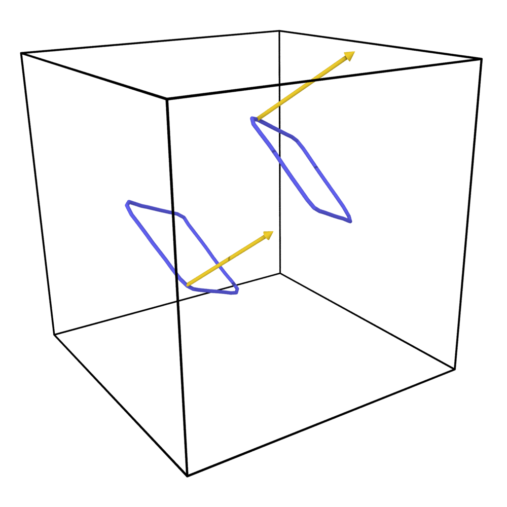
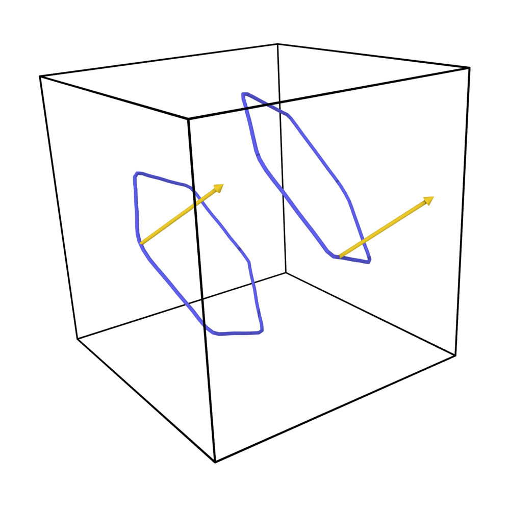

# Input generators

The scripts in `Examples/generators/` write DISCO YAML inputs. Each generated `<name>.yaml` comes with a
**ground-truth sidecar** `<name>.json` that records what the sample should contain. Compare it with
the output of a dislocation analysis (DXA, DANCE, …) to validate that analysis.

```
Examples/generators/
  exec_input.py                        shared helpers (no command line)
  make_single_loop.py                  one glissile loop: circular / square / rectangular / ⟨111⟩ parallelogram
  make_quadrupole.py                   4 loops on two {110} planes: junction | annihilation
  make_prismatic_dipole.py             rhombic prismatic dipole from 4 shear loops
  make_hexagonal_prismatic_dipole.py   hexagonal prismatic dipole from 6 shear loops
  make_prismatic_dipoles.py            N prismatic dipoles (rhombic or hexagonal) at random positions
  make_prismatic_loops.py              BCC prismatic loops with added / removed atoms
  make_fcc_loops.py                    FCC: perfect prismatic rhombi and / or Frank loops
  make_polycrystal_loops.py            polycrystal (BCC / FCC) populated with loops
```

## Conventions

- Every generator writes `Method: line` and keeps a `Loopon_size`, so that changing the file to
  `Method: loopons` gives the grid the generator was designed for.
- Python 3 with numpy. The scripts can be run from any directory; `--help` lists every option.
- **Slip systems** are read from `Parameters/BCC.txt` (`--bcc` to use another file).
  `--system N` is the position 1..48 in that file: 12 systems per ½⟨111⟩ Burgers vector, each
  listing 3 {110}, 3 {112} and 6 {123} planes. The same file and numbering are used by the DANCE
  analysis code, so `expected_slip_system` in the sidecar can be compared directly with what DANCE reports.
  This applies to the BCC scripts. `make_fcc_loops.py` has no DANCE table, so these two fields are `null`.
- **Lengths** are in Å, as in the input file. `--units a0` switches every length option to units of a0.
- b = (a0/2) m. Rectangles have their sides along m (screw, `Half_m`) and along p = m × n (edge, `Half_p`).
- DISCO moves every loop centre along n onto the nearest mid-plane between atomic planes
  (see [Input file](input.md#loop-centre-and-cut-plane)). The scripts reproduce that rule in Python.
  The quadrupole and prismatic scripts put their planes on mid-planes directly, so nothing moves.
- **Box:** by default, the smallest even cube that leaves 12 a0 between the loops and the box faces
  (`--cells` to override).
- **Output format:** `xyz` by default (`--format lammps|both|none`).

## `make_single_loop.py`: one glissile loop

```bash
python3 make_single_loop.py --system 1                          # circle R = 8 a0 on BCC.txt system 1
python3 make_single_loop.py --shape square --system 4           # {112}
python3 make_single_loop.py --shape rectangular --system 7 --corner-radius 13.2
python3 make_single_loop.py --family all --outdir db/           # all 48 systems
python3 make_single_loop.py --family 123 --units a0 --radius 10 --outdir db/
python3 make_single_loop.py --m 1 -1 1 --n 1 1 0 -o my_loop.yaml
```

The default sizes are:

- circle: R = 8 a0;
- square: half-side 8 a0;
- rectangle: `Half_m` = 16 a0, `Half_p` = 8 a0.

The default loopon step is 0.4 a0. Files are named like `circ_f112_sys04.yaml`
(`rect_rounded_…` when `--corner-radius` > 0).

**⟨111⟩ parallelogram.** `--shape parallelogram` writes `Shape: parallelogram` with `Dir_1` = b
and `Dir_2` = the other ⟨111⟩ of the plane. This gives two screw sides and two mixed sides at 70.5° to b,
the faceted shape of a low-temperature BCC loop. A {110} plane holds exactly two ⟨111⟩
directions, so this shape exists on {110} only (`--family 112/123` is refused). The sizes are
`--half-screw` (default 16 a0) and `--half-mixed` (8 a0).

```bash
python3 make_single_loop.py --shape parallelogram --system 1                 # -> para_f110_sys01.yaml
python3 make_single_loop.py --shape parallelogram --family 110 --outdir db/  # the 12 {110} systems
```

## `make_quadrupole.py`: junction and annihilation quadrupoles

See [Quadrupoles](quadrupoles.md#make_quadrupolepy-any-pair-of-110-planes), including
[several quadrupoles in one sample](quadrupoles.md#several-quadrupoles-in-one-sample-tiles).

## `make_prismatic_loops.py`: prismatic loops with added or removed atoms

Use this for prismatic loops that must survive thermal MD. Each loop has b out of its plane
(b · n ≠ 0), and exec_cuda adds (interstitial) or removes (vacancy) the slab of atoms inside it
(see [Input file](input.md#prismatic-and-mixed-loops-b-n-0)).

- `--habit 111`: pure-edge loop, n ∥ b. `--habit 110`: mixed loop on a {110} plane at 35.3° from b.
- `--type interstitial | vacancy | mixed`.
- With several loops (`--count`), loops of opposite type and the same b are never placed on the
  same glide prism, because they would glide together and annihilate.
- `--shape circular | hexagonal`. `--radius` is the radius, or the hexagon circumradius.
  `--corner-radius` rounds the hexagon corners. `--vertex-dir` sets the direction of the first
  vertex, which must lie in the plane of every loop, so give `--b` with it.
- `Loopon_size` defaults to 0.33 d. It matters only if you switch the file to `Method: loopons`.

```bash
python3 make_prismatic_loops.py                                     # 1 interstitial loop, R = 20 Å
python3 make_prismatic_loops.py --count 6 --type mixed --radius 15 --cells 50 --seed 2
python3 make_prismatic_loops.py --b 1 1 1 --type vacancy --habit 110 -o vac110.yaml
python3 make_prismatic_loops.py --shape hexagonal --radius 22 --corner-radius 2 -o hex.yaml
python3 make_prismatic_loops.py --shape hexagonal --b 1 1 1 --vertex-dir 1 1 -2 -o hex110.yaml
```

## `make_fcc_loops.py`: FCC prismatic and Frank loops

Writes FCC samples (`Lattice: FCC`, `Element` Cu by default, a0 = 3.615 Å) with loops made by adding
or removing atoms, so they survive thermal MD. Use it for one loop or for an irradiation-like
population of interstitial and vacancy loops.

- `--kind prismatic` (default): perfect b = ½⟨110⟩, loop plane normal to b ({110}), 2 atomic planes
  added or removed. Exactly two {111} planes contain b, so the loop is a **rhombus** whose sides are
  its intersections with them: ⟨112⟩ directions at 70.5° / 109.5° (a DISCO `parallelogram`). Each
  side glides along b on its own {111} plane, so the loop moves rigidly along a parallelepiped glide
  prism. This is the FCC counterpart of the hexagonal ½⟨111⟩ prism in BCC. `--shape circular` gives
  a round loop on the same plane.
- `--kind frank`: faulted b = a0/3⟨111⟩ on the {111} plane normal to b. The loop is sessile, with one
  {111} layer added (extrinsic fault) or removed (intrinsic fault); see
  [Faulted loops](input.md#faulted-loops-fcc). `--shape hexagonal` (default) or `triangular`, with
  sides along ⟨110⟩ as in quenched and irradiated FCC metals, or `circular`.
- `--kind mixed`: each loop is Frank with probability `--frank-fraction` (default 0.5), perfect
  prismatic otherwise.
- `--type interstitial | vacancy | mixed`. `--size`: rhombus side, polygon circumradius, or circle
  radius (Å). `--b`: one Burgers direction (a ⟨110⟩ for prismatic, a ⟨111⟩ for Frank loops).
- Placement as in `make_prismatic_loops.py`: random centres (`--seed`), `--gap` between bounding
  spheres, and perfect loops of opposite type with the same b never on overlapping glide prisms.
  Frank loops are sessile and only need `--gap`. Loops may cross the periodic boundary.
- `--element`, `--mass`, `--a0` for another metal (e.g. `--element Ni --a0 3.52`).
- The sidecar's `expected.loops[]` gives, per loop, the kind, type, Burgers vector (`1/2[1 1 0]`,
  `1/3[1 1 1]`), the number of atomic planes, the nominal number of atoms added (ρ A |b·n̂|; the code's
  count differs by the atoms cut by the contour), and the glide planes (prismatic) or the stacking
  fault (Frank).

```bash
python3 make_fcc_loops.py                                          # 1 interstitial rhombus, side 25 Å
python3 make_fcc_loops.py --count 8 --type mixed --seed 2          # 8 prismatic rhombi
python3 make_fcc_loops.py --kind frank --shape triangular --type vacancy --size 20
python3 make_fcc_loops.py --kind mixed --count 12 --type mixed --frank-fraction 0.5 --cells 60
python3 make_fcc_loops.py --kind prismatic --b 1 -1 0 --size 30 --element Ni --a0 3.52
```

Checked with OVITO DXA (FCC) on 22 loops (single rhombus, 8 mixed rhombi, 3 vacancy Frank triangles,
10 mixed Frank and prismatic loops): one loop per generated loop with its Burgers vector (½⟨110⟩ or
⅓⟨111⟩) and no other segment, HCP fault layers inside the Frank loops only, and atom counts within
the contour scatter of the sidecar value.

## `make_polycrystal_loops.py`: dislocation-populated polycrystal

Draws the grains (seeds uniform in the box, uniformly random orientations) and writes them as an
explicit `Grain_list` (Center + Bunge Euler), then adds loops until the nominal line length reaches
`--density` (m⁻²) or `--loops`. See [Polycrystals](polycrystal.md) for clipping and skipping.

- Each loop: centre uniform in the box, grain = nearest seed (so grains get loops in proportion to
  their volume), at least `--gap` from every other loop (bounding spheres, periodic).
- `--kinds name:weight,...`. FCC: `glide` (½⟨110⟩{111}, circular), `shockley` (⅙⟨112⟩{111}, stable
  sense only), `frank` (⅓⟨111⟩, hexagon with ⟨110⟩ sides), `prismatic` (½⟨110⟩ rhombus on its
  {111} glide prism). BCC: `glide` (½⟨111⟩{110}), `prismatic` (½⟨111⟩ hexagon with ⟨112⟩ sides on its
  {110} glide prism). Default FCC `glide:4,frank:3,prismatic:2,shockley:1`, BCC `glide:3,prismatic:2`.
- `--size` (median radius / reach, Å) and `--size-sigma` (lognormal log-sd); `--type` for the loops
  with b · n ≠ 0.
- The sidecar lists the grains (centre, Euler, R) and the loops (grain, kind, type, crystal and box
  Burgers vectors, `may_clip` when the bounding sphere leaves the grain cell). DISCO's
  `Poly_..._loops.txt` gives the final status of each loop and the density after clipping.

- Twins: `--twins-per-grain λ` gives each grain a Poisson(λ) number of parallel lamellae (random
  {111} / {112} variant), thickness lognormal (`--twin-thickness`, `--twin-sigma`), separated by at
  least 3 planes plus up to `--twin-gap` Å; a stack stops where it would leave its grain. Loops whose
  centre falls in a lamella are read by DISCO in the twin frame; the sidecar gives R_twin and each
  loop's approximate region. `--loops 0` writes twins only.

```bash
python3 make_polycrystal_loops.py                                  # Cu, 8 grains, 1e16 m^-2
python3 make_polycrystal_loops.py --twins-per-grain 1.5 --twin-thickness 15 --density 2e16
python3 make_polycrystal_loops.py --twins-per-grain 2 --loops 0    # twins only
python3 make_polycrystal_loops.py --grains 12 --box 200 --density 5e16 --seed 5
python3 make_polycrystal_loops.py --kinds glide:1,frank:1 --size 25 --type interstitial
python3 make_polycrystal_loops.py --lattice BCC --kinds glide:2,prismatic:1
```

## Prismatic dipoles

!!! warning "Not stable at finite temperature"
    These dipoles are built from shear loops only, so no atom is added or removed. The two loops of
    opposite sign lie on the same glide prism, and they attract each other. At finite temperature
    they glide together and annihilate, even without stress. For stable prismatic loops use
    `make_prismatic_loops.py`.

`make_prismatic_dipole.py` and `make_hexagonal_prismatic_dipole.py` build a prismatic dipole from
shear loops:

- Shear loops with the same b sit on the faces of a glide prism around b: two {110} planes
  (rhombic tube) or three (hexagonal tube).
- Every face normal points out of the tube. The screw sides of neighbouring faces therefore
  coincide with opposite line senses and cancel.
- What remains are the edge sides at the two tube ends: two prismatic loops of opposite sign,
  normal to b, separated by `--separation` along b.
- Exact cancellation needs the shared sides to coincide. The face planes are put on mid-planes, and
  the half-lengths are written as (k + ½) `Loopon_size`, the prism half-side and half the
  separation. That is the exact contour with `Method: line`, and the effective loop extent of the
  loopon grid with `Method: loopons` (the bound lies halfway between grid rows), so both methods
  cancel the screw sides. The values actually used are printed.

```bash
python3 make_prismatic_dipole.py                       # ./prismatic_dipole.yaml (+ .json)
python3 make_prismatic_dipole.py --side 40 --separation 120 --cells 60 -o dipole2.yaml
python3 make_prismatic_dipole.py --b 1 1 1 --n1 1 -1 0 --n2 0 1 -1
python3 make_hexagonal_prismatic_dipole.py --side 25 --separation 100 --b 1 1 1 -o hex2.yaml
```

<div class="grid" markdown>
<figure markdown="span">
  { height="220" }
  <figcaption>Rhombic prismatic dipole</figcaption>
</figure>
<figure markdown="span">
  { height="220" }
  <figcaption>Hexagonal prismatic dipole</figcaption>
</figure>
</div>

### `make_prismatic_dipoles.py`: N dipoles at random positions

Writes `--count N` prismatic dipoles into one input file. Each is built exactly as by the scripts
above, then drawn at random (`--seed`):

- **b:** one of the four ⟨111⟩ directions with a random sign, so both the direction and which end
  loop is positive vary. By default the directions are dealt in shuffled rounds of four, so the
  families stay balanced (12 dipoles = 3 per family). `--b-draw random` draws each one
  independently instead. `--b` fixes the direction for every dipole, and `--no-random-sign` also
  fixes the sign.
- **Planes (rhombic):** one of the three {110} pairs that contain b.
- **Separation:** `--separation S` for all dipoles, or `--separation MIN MAX` for a uniform random
  value per dipole, adjusted to the loopon grid.
- **Position:** a random BCC lattice site of the box (cube corner or body centre), so every face
  plane stays on its mid-plane. A dipole is redrawn when its bounding sphere comes closer than
  `--gap` (10 Å) to that of another dipole, using the periodic minimum image.
- **Margin (optional):** with `--margin M`, every shear loop also stays at least M Å from the box
  faces, so no dipole crosses the periodic boundary. Use it when a free surface will be opened
  later, for instance for indentation. Without it, dipoles may wrap across the boundary.

**One type per sample.** The loopon step that makes the screw sides cancel exactly is set by the
side length: the half-side must be (k + ½) `Loopon_size`, with the faces on mid-planes. No common
step exists for a rhombic and a hexagonal dipole, whose half-sides are odd multiples of d/√3 and
of d/(2√3) respectively (d = {110} spacing). So all dipoles of a sample share `--type` and
`--side`, and only the separation varies.

**Box.** `--cells N` gives a cube and `--cells NX NY NZ` any orthorhombic box, in unit cells.
`--size LX LY LZ` gives it in Å, rounded to whole cells. Odd cell counts are fine. By default the
box is the cube in which the dipoles' bounding spheres (with half the gap) fill `--fill` = 15 % of
the volume, enlarged if needed to fit `--margin`.

```bash
python3 make_prismatic_dipoles.py --count 10                       # 10 hexagonal dipoles, random b
python3 make_prismatic_dipoles.py --count 20 --type rhombic --side 40 --separation 60 120 --seed 3
python3 make_prismatic_dipoles.py --count 8 --b 1 1 1 --cells 120 --format lammps
# indentation slab: 12 dipoles (3 per <111> family), none crossing the box faces
python3 make_prismatic_dipoles.py --count 12 --side 40 --separation 50 --size 600 600 300 --margin 10 --gap 20
```

If the dipoles do not fit, the script stops and says how many it placed. Increase the box, or
lower `--count`, `--fill`, `--gap` or `--margin`. With `--margin`, a dipole's centre must stay
its full reach plus M away from every face, which shrinks the usable volume quickly in small
boxes.

The sidecar's `expected` holds `closed_loops` = 2N, `screw_length` = 0, and `per_dipole[]`: shear-loop
numbers, b, centre, planes, side, separation and the centres of the two prismatic loops.
`placement` records the cells, gap, margin, seed and b draw.

!!! check "Verified"
    Three hexagonal dipoles (side 25.6 Å, random b and separation) were run through `exec_cuda`
    and analysed with OVITO DXA. DXA finds exactly 6 closed ½⟨111⟩ loops, two per dipole with
    ±b along that dipole's Burgers vector, at the predicted positions. The same holds in a
    61 × 51 × 41 box with `--margin 6`, with odd cell counts on every axis, a different count per
    axis, and no loop crossing the boundary.

## Sidecar (`<name>.json`)

- `generator`, `command`: the exact command line that wrote the file.
- `general`: the YAML `general:` block.
- `loops[]`, one entry per loop:
    - shape and sizes;
    - `center_requested` and `center_snapped` (after the mid-plane rule);
    - `m`, `n`, `burgers_A`, `plane_family`;
    - `expected_burgers_type`, `expected_slip_system` (indices in `BCC.txt`);
    - `loopons`: the number of loopons DISCO will generate.
- `expected`: what the sample should contain.
    - Single loop: one closed ½⟨111⟩ loop, plus the nominal screw and edge lengths for rectangles.
    - Quadrupole:
        - for each corner: the loop pair, the product Burgers vector (units of a0),
          a⟨100⟩ or a⟨110⟩, Frank's rule, and the `BCC.txt` junction type (5/6/7) for a⟨100⟩;
        - circles: the corner reactions are what relaxation should produce, while the unrelaxed
          sample holds 4 crossing loops;
        - squares and rectangles: each corner leg already carries the product Burgers vector
          (`shared_side: true`).
    - Tiled quadrupoles (`--tiles`): `tiles[]` with, per tile, its centre, shift, planes, mode,
      Burgers vectors and corner reactions (global loop numbers), plus `frank_favourable_corners`.
    - Prismatic dipole: two closed loops of opposite sign, normal ∥ b, with no screw part, plus their
      side length and position along b.
    - Several prismatic dipoles: 2N closed loops and `per_dipole[]`.
    - FCC loops: `closed_loops`, `burgers_families` and `loops[]` (see `make_fcc_loops.py`).
- Coordinates are those of the input file: origin at the box centre (see [Output files](output.md)).
