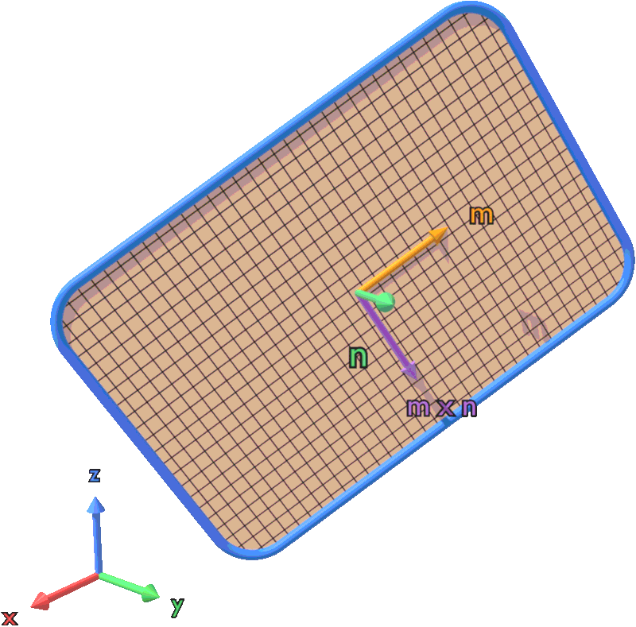
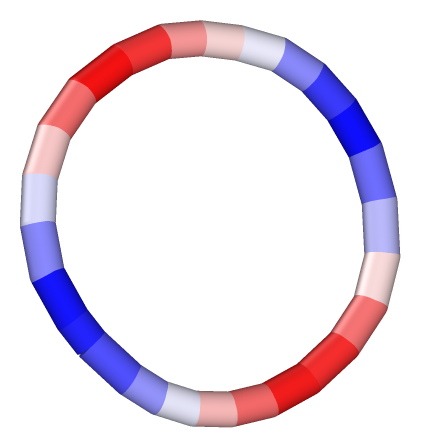
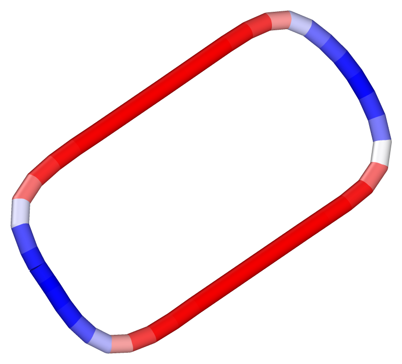
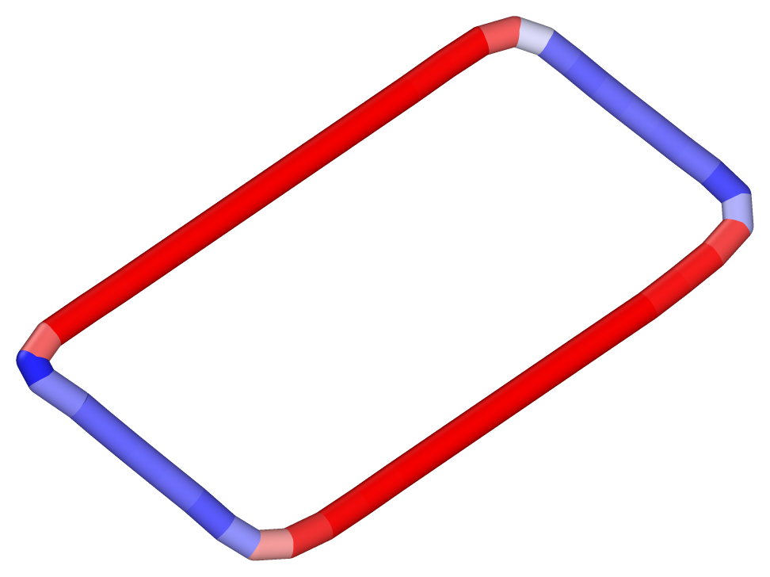
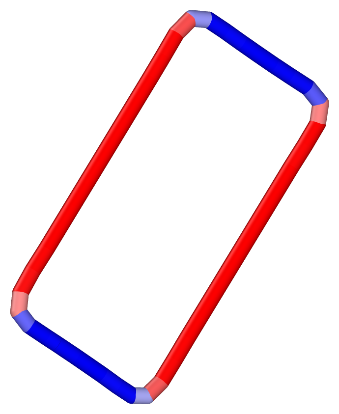
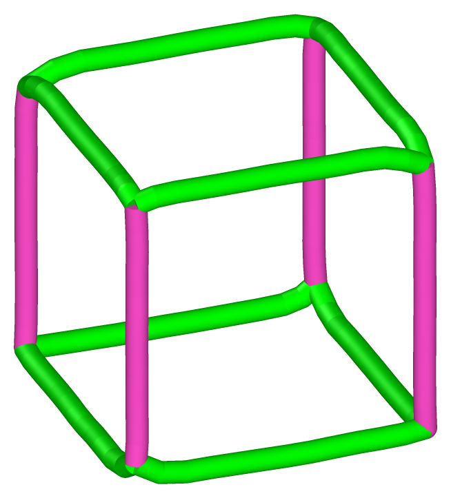
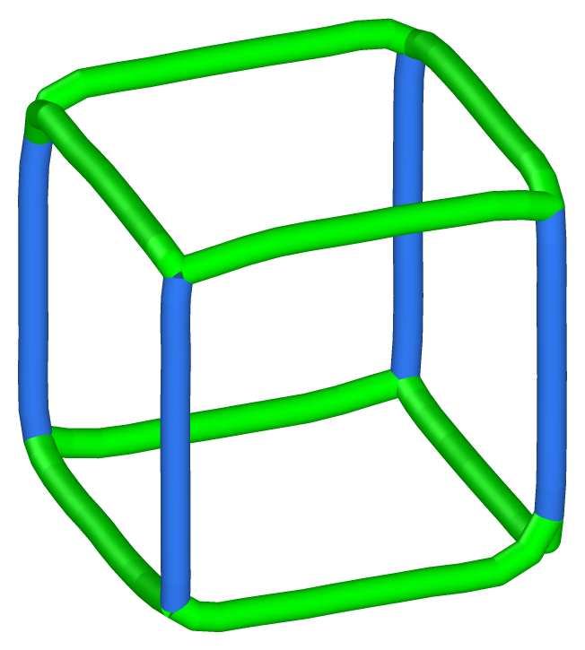
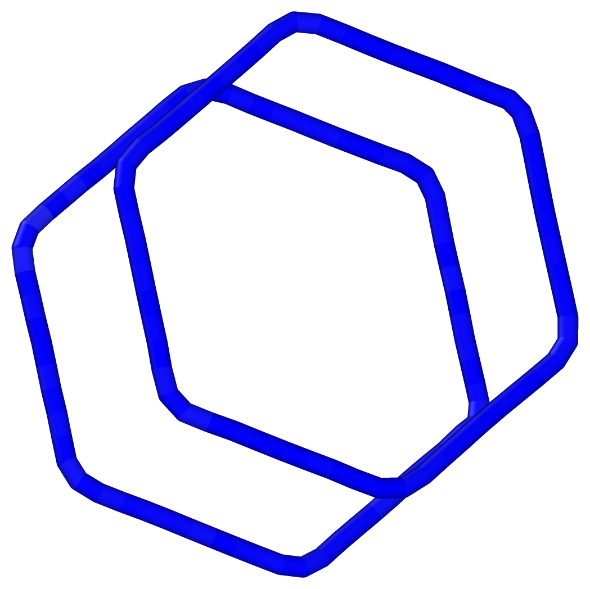
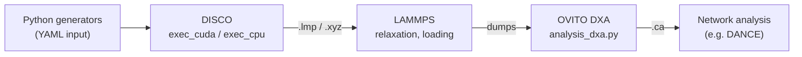
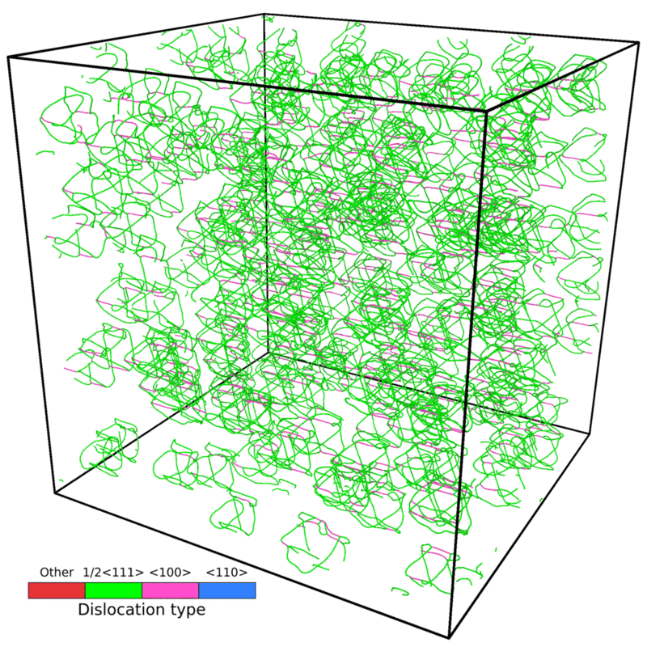

# DISCO

**DISlocation COnfiguration generator.** DISCO builds atomistic BCC samples that contain
dislocation loops, ready for molecular dynamics.

Each loop is tiled by small square (or rhombic) elements, the *loopons*. The displacement of
every atom is the sum of the elastic fields of all loopons (Kroupa, 1966), with periodic images.
The sum runs on a GPU (CUDA) or on the cores of a CPU (OpenMP); both backends give the same sample.

<figure markdown="span">
  { width="380" }
  <figcaption>A dislocation loop for the slip system [−111](110), tiled by loopons (black grid).
  m is the Burgers vector direction, n the loop-plane normal.</figcaption>
</figure>

## What it does

- BCC lattice of `Nx × Ny × Nz` cubic cells, any lattice parameter.
- Any number of loops: circles, rectangles (optionally rounded, optionally rotated in their plane)
  and parallelograms, on any plane `n` with Burgers vector `b = a0/2 m`.
- Loop centres are moved onto the mid-plane between two atomic planes of the loop plane family.
- Output as extended XYZ (OVITO) or LAMMPS data file.
- Python generators for common configurations: single loops on all 48 BCC slip systems,
  junction and annihilation quadrupoles, prismatic dipoles, and large tiled samples with
  random positions. Each generated input comes with a JSON file holding the expected
  dislocation content.

| | | | |
|:-:|:-:|:-:|:-:|
| { width="110" } | { width="110" } | { width="110" } | { width="110" } |
| {110} circle | {110} rounded rectangle | ⟨111⟩ parallelogram | {112} rectangle |
| { width="110" } | { width="110" } | { width="110" } | |
| tube, junction | tube, annihilation | prismatic dipole | |

*Dislocation lines extracted by OVITO's DXA from samples written by DISCO.*

## Workflow



## Quick start

```bash
git clone https://github.com/lafourcadep/DISCO.git
cd DISCO/Code
make exec_cpu                                   # CPU build (g++ + OpenMP + yaml-cpp)
./exec_cpu ../Examples/quadrupole_circle.yaml   # writes Geo_40x40x40_with_loop.lmp
```

With a CUDA toolkit, `make GPU_ARCH=sm_80` builds `exec_cuda` (see [Installation](installation.md)).

<figure markdown="span">
  { width="460" }
  <figcaption>Early state of the dislocation network in a 32-million-atom BCC Ta sample
  seeded with randomly placed dislocation quadrupoles.</figcaption>
</figure>

## License

MIT. See [`LICENSE`](https://github.com/lafourcadep/DISCO/blob/main/LICENSE).
