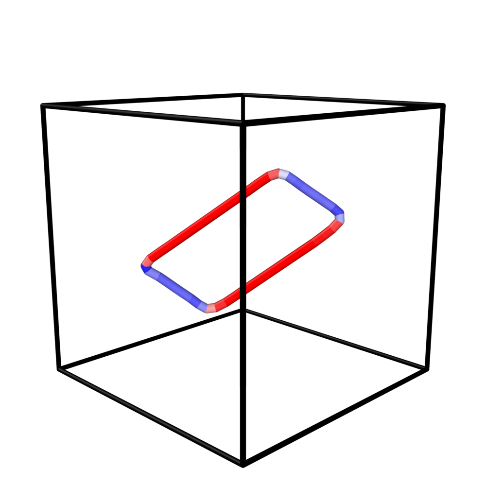

# Input file

## Running

```bash
./exec_cuda <input.yaml>          # GPU
./exec_cuda --cpu <input.yaml>    # CPU backend of the same binary
OMP_NUM_THREADS=16 ./exec_cpu <input.yaml>
```

`exec_cuda` falls back to the CPU backend, with a warning, when it finds no usable CUDA device.
The first lines of the log name the backend (`--- GPU: <name> ---` or
`--- CPU: <N> OpenMP threads ---`).

At the end the program prints a timing summary. It gives the wall-clock time and the share of each phase
(input, lattice, loopons, transfers, kernels, final positions, output), then the kernel time
per loop and its throughput in atom–loopon pairs per second. The per-loop lines appear only when
there are 20 loops or fewer.

## Format

The input is YAML: a `general:` block and a `dislocations:` list with one entry per loop.
Key order is free and `#` comments are allowed. **An unknown or missing key stops the program
with a message**, so a typo cannot silently fall back to a default.

!!! note "Units"
    Every length is in Ångström.

```yaml
general:
  a0: <lattice_parameter>                # Å
  Nx: <cells_x>                          # box = Nx × Ny × Nz cubic cells
  Ny: <cells_y>
  Nz: <cells_z>
  Loopon_size: <step>                    # Å, loopon grid step, the same for every loop
  Output_format: <xyz|lammps|both|none>  # optional, default xyz; none = no file (timing runs)

dislocations:
  - Shape: <circular|rectangular|parallelogram>
    Radius: <value>          # circular only (Å)
    Half_m: <value>          # rectangular only (Å): half-length along m (screw sides)
    Half_p: <value>          # rectangular only (Å): half-length along m × n (edge sides)
    Corner_radius: <value>   # rectangular only (Å), 0 = sharp corners
    Side: [sx, sy, sz]       # rectangular only, optional: direction of the Half_m axis
                             #   (in the plane, Side·n = 0); default m. Half_p is along Side × n
    Half_1: <value>          # parallelogram only (Å): half-length along Dir_1
    Half_2: <value>          # parallelogram only (Å): half-length along Dir_2
    Dir_1: [d1x, d1y, d1z]   # parallelogram only: first side direction, in the plane
    Dir_2: [d2x, d2y, d2z]   # parallelogram only: second side direction, in the plane, not ∥ Dir_1
    Center: [cx, cy, cz]     # Å, origin at the box centre (moved onto a mid-plane, see below)
    m: [mx, my, mz]          # Burgers vector direction (integer Miller indices)
    n: [nx, ny, nz]          # loop-plane normal (integer Miller indices)
  - ...
```

The Burgers vector is **b** = (a0/2) **m**, so |b| = a0 |m| / 2. The log prints the size of each loop
in Å and in units of |b|.

## Loop shapes

**Circle.** A disc of radius `Radius` in the plane normal to n.

**Rectangle.** By default the sides run along m (screw character, half-length `Half_m`) and along
m × n (edge character, half-length `Half_p`). `Corner_radius` rounds the corners.
`Side` turns the rectangle in its plane without changing b. `Half_m` is then measured along
`Side` and `Half_p` along `Side × n`, and the sides have mixed character. The quadrupole generator
uses this to put the sides of neighbouring loops exactly on the line where their planes meet.

**Parallelogram.** Sides along `Dir_1` and `Dir_2`, which need not be orthogonal, so the
characters of the two side pairs are set independently. The loopon grid is oblique, with step
`Loopon_size` along each direction, and each loopon carries the cell area
`Loopon_size² · sin(Dir_1, Dir_2)`. The tiles follow both sides exactly. The effective half-lengths
are (k + ½) `Loopon_size` with k = floor(Half / `Loopon_size`).

A typical use is the faceted shape of a low-temperature BCC loop on {110}: `Dir_1` = b (screw sides),
`Dir_2` = the other ⟨111⟩ of the plane (mixed sides at 70.5° to b). For example, for b = ½[111] on (1−10):
`Dir_1: [1, 1, 1]`, `Dir_2: [1, 1, -1]`
(`Examples/generators/make_single_loop.py --shape parallelogram` writes these).

<figure markdown="span">
  { width="300" }
  <figcaption>Faceted ⟨111⟩ loop: screw sides along b, mixed sides at 70.5°.</figcaption>
</figure>

## Loop centre and cut plane

The loop surface must lie halfway between two dense atomic planes of its (hkl) = n family.
The code moves the requested centre along n onto the nearest such mid-plane, without changing the
in-plane position. It prints the shift and the plane spacing d:

- d = a0/|n| if h + k + l is even;
- d = a0/(2|n|) if h + k + l is odd.

This gives d = 2.335 Å for {110}, 1.348 Å for {112} and 0.883 Å for {123} (a0 = 3.3024 Å).
A centre exactly on an atomic plane goes to the mid-plane on the +n side.

## Example: one circular and one rounded-rectangle loop

```yaml
general:
  a0: 3.3024
  Nx: 60
  Ny: 60
  Nz: 60
  Loopon_size: 1.32096
  Output_format: lammps

dislocations:
  - Shape: circular
    Radius: 26.4192
    Center: [-39.6288, -39.6288, 0]
    m: [1, -1, 1]
    n: [1, 1, 0]
  - Shape: rectangular
    Half_m: 34.3195
    Half_p: 19.8144
    Corner_radius: 9.9072
    Center: [39.6288, 39.6288, 0]
    m: [-1, 1, 1]
    n: [1, 0, 1]
```

More templates are in `Examples/` (`cubic_base.yaml`, `orthorhombic_base.yaml`,
`quad_junc.yaml`, `quad_anni.yaml`, `quadrupole_circle.yaml`, `rectangular.yaml`).
The [generators](generators.md) write such files for you.

## Units

| Quantity | Unit |
|---|---|
| Lattice parameter `a0` | Å |
| Atom and loopon positions, all input lengths | Å |
| Burgers vector b | Å |
| Loop-plane normal n | dimensionless (normalised internally) |
| Loopon area dS | Ų |
