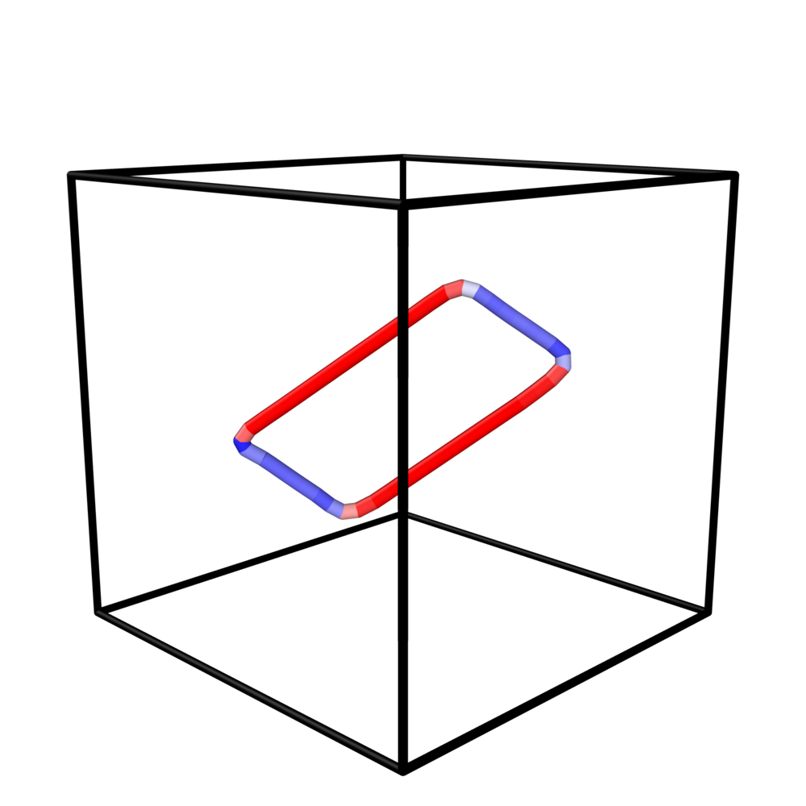

# Input file

## Running

```bash
./exec_cuda <input.yaml>          # GPU
./exec_cuda --cpu <input.yaml>    # CPU backend of the same binary
OMP_NUM_THREADS=16 ./exec_cpu <input.yaml>
./exec_mvcc --fp32 <input.yaml>   # Apple GPU (see CPU or GPU)
```

`exec_cuda` falls back to the CPU backend, with a warning, when it finds no usable CUDA device.
The first lines of the log name the backend (`--- GPU: <name> ---` or
`--- CPU: <N> OpenMP threads ---`).

At the end the program prints a timing summary. It gives the wall-clock time and the share of each phase
(input, lattice, loopons, transfers, kernels, final positions, output), then the kernel time
per loop and its throughput in atom–segment (`Method: line`) or atom–loopon (`Method: loopons`)
pairs per second. The per-loop lines appear only when
there are 20 loops or fewer.

## Format

The input is YAML: a `general:` block and a `dislocations:` list with one entry per loop.
Key order is free and `#` comments are allowed. **An unknown or missing key stops the program
with a message**, so a typo cannot silently fall back to a default.

!!! note "Units"
    Every length is in Ångström.

```yaml
general:
  Lattice: <BCC|FCC>                     # optional, default BCC
  Element: <symbol>                      # optional, default Ta: species name in the output files
  Mass: <mass>                           # optional (Dalton), LAMMPS Masses; default: standard mass
                                         #   of Element (common BCC / FCC metals), required otherwise
                                         #   A warning is printed if Element is not of this Lattice
                                         #   at room temperature (e.g. Ni with BCC), or if Lattice is
                                         #   FCC and Element is left at its default (Ta)
  a0: <lattice_parameter>                # Å
  Nx: <cells_x>                          # box = Nx × Ny × Nz cubic cells
  Ny: <cells_y>
  Nz: <cells_z>
  Method: <line|loopons>                 # optional, default line (see "Field method")
  Segment_tolerance: <eps>               # line only, optional, default 0.01 Å
  Loopon_size: <step>                    # Å, loopon grid step, the same for every loop;
                                         #   required with loopons, optional (unused) with line
  Output_format: <xyz|lammps|both|none>  # optional, default xyz; none = no file (timing runs)

dislocations:
  - Shape: <circular|rectangular|parallelogram|polygon|hexagonal>
    Radius: <value>          # circular only (Å)
    Half_m: <value>          # rectangular only (Å): half-length along m (screw sides)
    Half_p: <value>          # rectangular only (Å): half-length along m × n (edge sides)
    Corner_radius: <value>   # rectangular (required), polygon / hexagonal (optional, default 0), Å;
                             #   0 = sharp corners
    Side: [sx, sy, sz]       # rectangular only, optional: direction of the Half_m axis
                             #   (in the plane, Side·n = 0); default m. Half_p is along Side × n
    Half_1: <value>          # parallelogram only (Å): half-length along Dir_1
    Half_2: <value>          # parallelogram only (Å): half-length along Dir_2
    Dir_1: [d1x, d1y, d1z]   # parallelogram only: first side direction, in the plane
    Dir_2: [d2x, d2y, d2z]   # parallelogram only: second side direction, in the plane, not ∥ Dir_1
    Sides: <N>               # polygon only: regular polygon with N >= 3 sides (hexagonal: 6)
    Circumradius: <value>    # polygon / hexagonal (Å): centre-to-vertex distance
    Vertex_dir: [vx, vy, vz] # polygon / hexagonal, optional: centre -> first vertex, in the plane;
                             #   default: the in-plane grid axis (see below)
    Vertices: [[x, y, z], ...]  # polygon only, instead of Sides / Circumradius / Vertex_dir:
                             #   convex contour, offsets from Center in Å, in the plane, in order
    Center: [cx, cy, cz]     # Å, origin at the box centre (moved onto a mid-plane, see below)
    m: [mx, my, mz]          # Burgers vector b = (a0/2) m: integers, or exact fractions p/q
                             #   for FCC partials (Frank [2/3, 2/3, 2/3], Shockley [1/3, 1/3, -2/3])
    n: [nx, ny, nz]          # loop-plane normal (integer Miller indices)
    Matter: auto             # optional, loops with b·n ≠ 0 only: auto (default) adds or removes
                             #   atoms, none applies the displacement field only
  - ...
```

The Burgers vector is **b** = (a0/2) **m**, so |b| = a0 |m| / 2. The log prints the size of each loop
in Å and in units of |b|.

## Lattice

| `Lattice` | Atoms per cubic cell | Perfect Burgers vectors (b = a0/2 m) | Typical glide plane |
|---|---|---|---|
| `BCC` (default) | 2 | m = ⟨111⟩ (½⟨111⟩), m = ⟨200⟩ (⟨100⟩) | {110}, {112}, {123} |
| `FCC` | 4 | m = ⟨110⟩ (½⟨110⟩), m = ⟨200⟩ (⟨100⟩) | {111} |

The program warns when b = (a0/2) m is not a translation of the lattice (for example m = ⟨111⟩ in
FCC): the cut surface of such a loop leaves a fault and the atoms added or removed by a prismatic
loop would not restore the perfect crystal. The two faulted FCC loops below are recognised and get
an information line instead. Perfect FCC loops dissociate into Shockley partials when the sample is
relaxed (energy minimization or MD), as expected.

### Faulted loops (FCC)

Write the fractional m as exact fractions (`2/3`, `-1/3`, …). A decimal such as `0.6667` is not
accurate enough for the plane-count check of the matter slab, which stops the program.

| Loop | m | n | Inside the contour |
|---|---|---|---|
| Frank, vacancy | ⅔⟨111⟩, m·n > 0 | ∥ m ({111}) | one {111} layer removed: intrinsic stacking fault |
| Frank, interstitial | ⅔⟨111⟩, m·n < 0 | ∥ m ({111}) | one {111} layer inserted: extrinsic stacking fault |
| Shockley | ⅓⟨112⟩, m·n = 0 | {111} containing m | glide loop: intrinsic stacking fault |

- **Frank loops** (b = a0/3⟨111⟩, sessile) add or remove one {111} layer (`Matter: auto`). An
  inserted layer cannot simply repeat its neighbour, as a perfect loop's copy at ±b does: that would
  stack it straight over its source (AA). Each copy is therefore also shifted in the plane by the
  Shockley vector that puts it on the third stacking position (…A **C** B C…, an extrinsic fault).
- **Shockley loops** (b = a0/6⟨112⟩) have a sign rule. Across the cut, the +n side moves by −b, and
  only one sense of b turns the layer above the cut into the next stacking position (intrinsic
  fault). The other sense puts it straight over the layer below (AA), which is not a stable fault:
  CNA shows no HCP layer and DXA finds no loop. On each {111} plane, three of the six ⅓⟨112⟩
  vectors are stable. The program prints a warning for the wrong sense; reverse m (or n). For
  n = [1 1 1], m = [-1/3, -1/3, 2/3] is stable and m = [1/3, 1/3, -2/3] is not.

Example: `Examples/fcc_faulted_loops.yaml` (Cu: interstitial and vacancy Frank loops, one Shockley
loop). DXA (FCC) finds ⅓⟨111⟩ Frank and ⅙⟨112⟩ Shockley loops, with HCP (fault) layers inside.

Example (Cu, two glide loops on {111}):

```yaml
general:
  Lattice: FCC
  Element: Cu                # Mass 63.546 from the built-in table
  a0: 3.615
  Nx: 40
  Ny: 40
  Nz: 40
dislocations:
  - Shape: rectangular
    Half_m: 30.0
    Half_p: 22.0
    Corner_radius: 0.4
    Center: [-25, -25, 0]
    m: [1, -1, 0]
    n: [1, 1, 1]
  - Shape: hexagonal
    Circumradius: 20.0
    Corner_radius: 2.0
    Center: [25, 25, 10]
    m: [1, 0, 1]
    n: [1, 1, -1]
```

The Python generators (`Examples/generators/`) write BCC inputs only.

## Field method

The displacement field of each loop is computed in one of two ways
(see [Theory](theory.md#line-integral-method-line)).

| `Method` | Field | Resolution parameter |
|---|---|---|
| `line` (default) | Closed-form line integral: exact isotropic field of the contour, made of straight segments | `Segment_tolerance` ε: circles and rounded corners are cut into chords of sagitta ≤ ε |
| `loopons` | Kroupa sum over a grid of infinitesimal loops tiling the cut | `Loopon_size`: grid step |

- Straight sides (rectangles, parallelograms, polygons) are exact with `line`. With
  ε = 0.01 Å a circle of radius 30 Å becomes 115–135 chords and a hexagon with rounded corners
  about 50 segments. A circle's chords keep its area; a rounded corner loses at most ~ε × arc length.
- `loopons` approximates the contour by the grid. The error falls with `Loopon_size` (for example,
  rms 9 × 10⁻³ Å at 0.4 a0 and 2.6 × 10⁻⁴ Å at 0.05 a0 on a glide quadrupole, compared with
  `line`), and the field is least accurate at the dislocation cores.
- Cost: an atom–segment pair costs about ten atom–loopon pairs, but a loop has far fewer segments
  than loopons (48 against 23 579 for a rounded hexagon of circumradius 30 Å at `Loopon_size`
  0.31 Å). See [CPU or GPU](backends.md#speed).
- `line` became the default after validation. Inputs written before it, with only `Loopon_size`,
  now run with `line`; add `Method: loopons` to reproduce older samples exactly.

## Loop shapes

**Circle.** A disc of radius `Radius` in the plane normal to n.

**Rectangle.** By default the sides run along m (screw character, half-length `Half_m`) and along
m × n (edge character, half-length `Half_p`). `Corner_radius` rounds the corners.
`Side` turns the rectangle in its plane without changing b. `Half_m` is then measured along
`Side` and `Half_p` along `Side × n`, and the sides have mixed character. The quadrupole generator
uses this to put the sides of neighbouring loops exactly on the line where their planes meet.

**Parallelogram.** Sides along `Dir_1` and `Dir_2`, which need not be orthogonal, so the
characters of the two side pairs are set independently. The loopon grid is oblique, with step
`Loopon_size` along each direction, and each loopon carries the cell area
`Loopon_size² · sin(Dir_1, Dir_2)`. The tiles follow both sides exactly. The effective half-lengths
are (k + ½) `Loopon_size` with k = floor(Half / `Loopon_size`).

A typical use is the faceted shape of a low-temperature BCC loop on {110}: `Dir_1` = b (screw sides),
`Dir_2` = the other ⟨111⟩ of the plane (mixed sides at 70.5° to b). For example, for b = ½[111] on (1−10):
`Dir_1: [1, 1, 1]`, `Dir_2: [1, 1, -1]`
(`Examples/generators/make_single_loop.py --shape parallelogram` writes these).

<figure markdown="span">
  { width="300" }
  <figcaption>Faceted ⟨111⟩ loop: screw sides along b, mixed sides at 70.5°.</figcaption>
</figure>

**Polygon / hexagon.** `Shape: hexagonal` is a regular hexagon. `Shape: polygon` is a regular
polygon with `Sides` sides, or any strictly convex polygon given by `Vertices`. A regular polygon is
set by `Circumradius` (centre to vertex) and `Vertex_dir`, the in-plane direction of its first vertex.
Without `Vertex_dir`, the first vertex lies along the default grid axis: m projected on the plane or,
for m ∥ n, n × e_k (e_k is the Cartesian axis with the smallest |n_k|). For n = ⟨111⟩ this axis is a
⟨110⟩ direction, so the sides run along ⟨112⟩. Give `Vertex_dir` along a ⟨112⟩ of the plane to get
sides along ⟨110⟩.
`Corner_radius` rounds every corner with an arc tangent to both sides. It is clamped to the largest
value that keeps every side, which for a regular polygon is the apothem; at that value the polygon
becomes its inscribed circle. The loopon grid is square, aligned with `Vertex_dir` (or the default
axis), and nodes on the contour are included. The log prints the exact contour area next to the
loopon area. `Vertices` must be strictly convex (no three aligned) and listed in order around the
contour, in either direction.

A typical use is the ½⟨111⟩{111} prismatic loop of BCC metals (interstitial or vacancy), for example:

```yaml
  - Shape: hexagonal
    Circumradius: 22.0
    Vertex_dir: [1, -1, 0]   # sides along <112>
    Corner_radius: 2.0       # optional
    Center: [0, 0, 0]
    m: [-1, -1, -1]          # m . n < 0: interstitial
    n: [1, 1, 1]
```

## Prismatic and mixed loops (b · n ≠ 0)

When m is not in the loop plane, the loop is prismatic (m ∥ n) or mixed. Opening or closing the cut
by |b · n̂| needs matter. With `Matter: auto`, the code adds or removes the atoms of a slab of
|b · n̂| = k d inside the contour. k is an integer because b is a lattice vector.

| sign of m · n | loop | atoms |
|---|---|---|
| m · n > 0 | vacancy | slab atoms removed before the displacement sum |
| m · n < 0 | interstitial | slab atoms duplicated; each copy is displaced by u(x) + sign(s) b and lands on the other lip of the cut |

This convention follows the Kroupa field: across the cut, u⁺ − u⁻ = −b.
The log prints the number of atoms added or removed and the expected value ρ A |b · n̂|.
The box is not deformed. The volume change ±A |b · n̂| is printed, so relax the box with NPT or
`fix box/relax`.

- The slab is bounded by mid-planes on either side of the cut. It holds 3 {111} planes for
  ½⟨111⟩ on (111), 1 {110} plane for ½⟨111⟩ on {110}, and 2 {100} planes for a⟨100⟩ on (100).
- With `Method: loopons`, the atoms kept next to the cut of an interstitial loop are only d/2 from
  the loopon plane. Use `Loopon_size` ≤ 0.35 d, for example 0.33 Å for {111}; the code warns
  otherwise. `Method: line` has no such limit: its jump across the cut is exactly −b.
- For m ∥ n, the in-plane grid axes are n × e_k (e_k is the Cartesian axis with the smallest |n_k|)
  and that vector × n. `Half_m` of a rectangle is measured along the first one, and the first vertex
  of a regular polygon without `Vertex_dir` lies along it.
- Any shape works, since the slab is cut by the loop contour. Sharp polygon corners need no rounding:
  for interstitial and vacancy hexagons on (111) (R = 22 Å, `Loopon_size` 0.33 Å), adaptive CNA finds
  no extra non-BCC atoms at the corners, and DXA finds one closed ½⟨111⟩ loop, with or without
  `Corner_radius`.
- `Examples/generators/make_prismatic_loops.py` writes such inputs.

A loop made this way is stable at temperature without stress. It can glide along b but cannot
vanish without climb. In contrast, the dipoles built from shear loops (`make_prismatic_dipole.py`)
contain no extra matter. Their two loops share one glide prism and annihilate by glide.

## Loop centre and cut plane

The loop surface must lie halfway between two dense atomic planes of its (hkl) = n family.
The code moves the requested centre along n onto the nearest such mid-plane, without changing the
in-plane position. It prints the shift and the plane spacing d:

- BCC: d = a0/|n| if h + k + l is even, d = a0/(2|n|) if h + k + l is odd;
- FCC: d = a0/|n| if h, k, l are all odd, d = a0/(2|n|) otherwise.

This gives, in BCC, d = 2.335 Å for {110}, 1.348 Å for {112} and 0.883 Å for {123} (a0 = 3.3024 Å),
and in FCC d = 2.087 Å for {111}, 1.278 Å for {110} and 1.808 Å for {100} (a0 = 3.615 Å).
A centre exactly on an atomic plane goes to the mid-plane on the +n side.

## Example: one circular and one rounded-rectangle loop

```yaml
general:
  a0: 3.3024
  Nx: 60
  Ny: 60
  Nz: 60
  Method: line
  Output_format: lammps

dislocations:
  - Shape: circular
    Radius: 26.4192
    Center: [-39.6288, -39.6288, 0]
    m: [1, -1, 1]
    n: [1, 1, 0]
  - Shape: rectangular
    Half_m: 34.3195
    Half_p: 19.8144
    Corner_radius: 9.9072
    Center: [39.6288, 39.6288, 0]
    m: [-1, 1, 1]
    n: [1, 0, 1]
```

More templates are in `Examples/` (`cubic_base.yaml`, `orthorhombic_base.yaml`,
`quad_junc.yaml`, `quad_anni.yaml`, `quadrupole_circle.yaml`, `rectangular.yaml`).
The [generators](generators.md) write such files for you.

## Units

| Quantity | Unit |
|---|---|
| Lattice parameter `a0` | Å |
| Atom and loopon positions, all input lengths (including `Segment_tolerance`) | Å |
| Burgers vector b | Å |
| Loop-plane normal n | dimensionless (normalised internally) |
| Loopon area dS | Ų |
