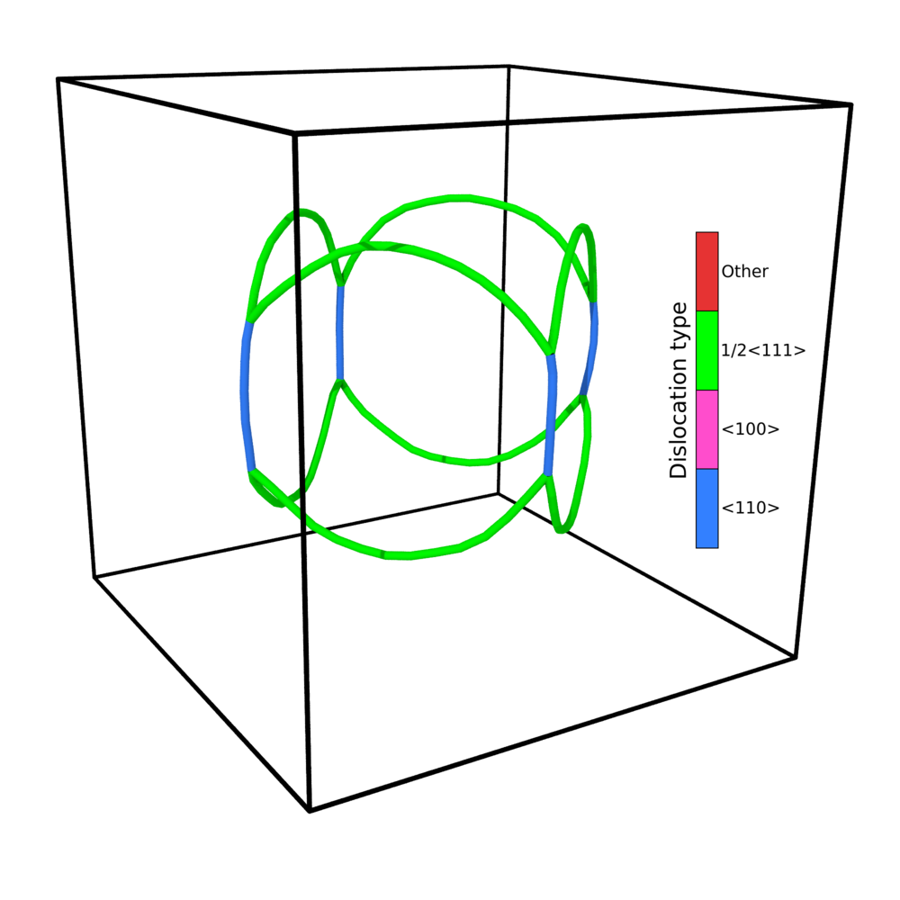
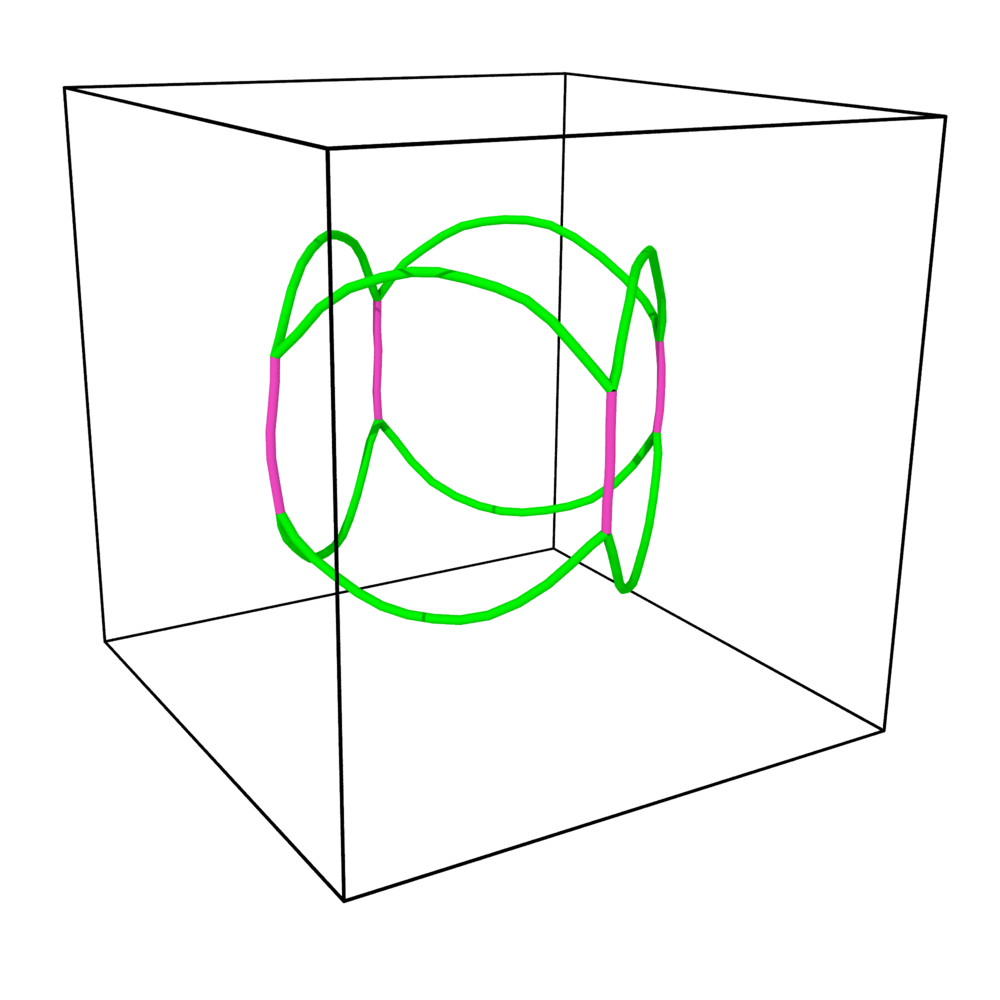
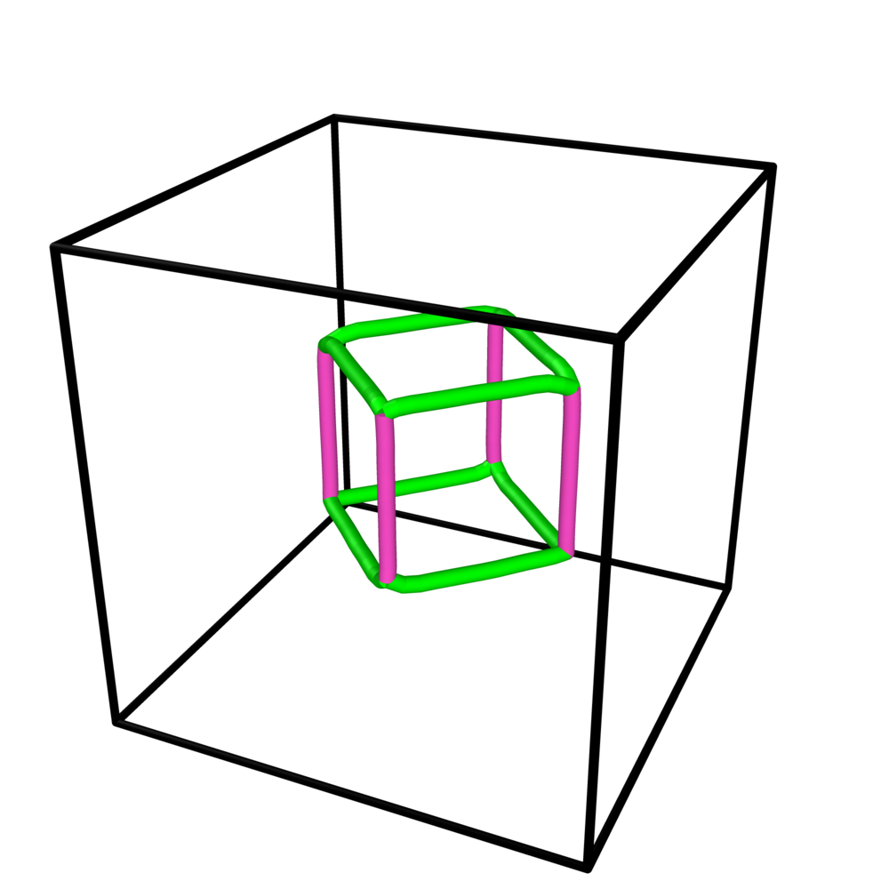

# Quadrupoles

Three scripts write quadrupoles of four loops:

| Script | Use |
|---|---|
| `Examples/generators/make_quadrupole.py` | Any pair of {110} planes; circular, square or rectangular loops; the Burgers vectors are searched for junction or annihilation; writes a ground-truth sidecar. With `--tiles`, many different quadrupoles in one sample. |
| `Code/generate_quadrupole.py` | Two fixed circular layouts (junction, annihilation) on a pair of {110} planes; standard library only. |
| `Examples/replicate_quadrupole/replicate_quadrupole.py` | Scales and tiles a reference quadrupole on a grid, with optional random shifts of each tile: large samples. |

<div class="grid" markdown>
<figure markdown="span">
  { width="300" }
</figure>
<figure markdown="span">
  { width="300" }
</figure>
</div>
<p align="center"><em>Glissile circular-loop quadrupoles (dislocation lines from DXA). Left: corner
products ⟨110⟩ (blue), no junction. Right: a⟨100⟩ junctions (pink). Green: ½⟨111⟩.</em></p>

## Background

**BCC slip systems.** In BCC metals the primary slip systems are {110}⟨111⟩, with
b = (a0/2)⟨111⟩. The glide condition b · n = 0 leaves 12 systems: 6 planes × 2 directions.

**Why four loops.** Four loops on two intersecting planes meet along the planes'
intersection lines. Depending on the Burgers vectors chosen, the segments that meet there
can react into a junction or annihilate. This gives controlled configurations for studying
these reactions and for checking dislocation-analysis tools.

**Frank's rule.** Two dislocations b₁ and b₂ meeting at a node can lower their elastic energy (∝ b²)
by combining into b₃ = b₁ + b₂ when |b₃|² < |b₁|² + |b₂|². In BCC, two ½⟨111⟩ can give
a⟨100⟩ (|b₃|² = a0² < 3a0²/2, favourable) or a⟨110⟩ (|b₃|² = 2a0² > 3a0²/2, unfavourable).

## `make_quadrupole.py`: any pair of {110} planes

- **Layout.** The four loops lie on the planes n1 · x = ∓s and n2 · x = ±s, the faces of a prism
  along L = n1 × n2.
    - Perpendicular planes (3 pairs) give L = ⟨100⟩ and a square cross-section.
    - All other pairs (12) meet at 60° and give L = ⟨111⟩ and a rhombic cross-section.
- **Square and rectangular loops** are the four faces of a closed tube. Each loop spans exactly its
  face width. Its two sides along L (input key `Side`) coincide with its neighbours' sides
  on the corner lines, so each corner leg carries b_A ± b_B directly.
- **Circular loops:** adjacent loops cross on the four corner lines ∥ L.
- **Loop order:** 1 = face −n1, 2 = +n2, 3 = −n2, 4 = +n1.
- **Burgers vectors are searched.** Each loop gets one of the ½⟨111⟩ of its plane; b ∥ L is excluded,
  since it would be pure screw on both planes.
    - `junction`: every corner product (both lines oriented along +L) is a⟨100⟩, which Frank's rule favours.
    - `annihilation`: opposite faces carry ±b, and every corner product is a⟨110⟩ (no junction).
    - Every {110} pair has solutions: at 90°, 32 junction and 8 annihilation assignments; at 60°,
      2 of each (a global sign flip). `--list` prints them.
- **Size, square or rectangular.** `--d` fixes the face half-width w. `Loopon_size` is tuned close
  to `--loopon-size` so that w = (k + ½) `Loopon_size`, which puts the loopon tile edge exactly on
  the corner line. Square: half-length along L = w. Rectangle: `--half-m` along L (default 14/11 w),
  rounded to the grid.
- **Size, circular.** Without `--radius`, the circle gets the smallest radius (rounded up to 0.1 Å)
  whose chords on every corner line overlap by `--overlap` (20 Å). An explicit radius is checked,
  and it is rejected if two neighbours do not cross. Below 5 Å of overlap the script warns:
  near-tangent loops are known to give DXA dangling ends.
- `--d` is the distance from the prism axis to each loop plane. The default is 7.5√2 a0, rounded down
  to a mid-plane: 14.5 d₁₁₀ = 33.86 Å. The YAML header lists the corner products.

```bash
python3 make_quadrupole.py                                            # junction, (110)/(-110), circles
python3 make_quadrupole.py --mode annihilation --shape square
python3 make_quadrupole.py --planes 1 1 0 0 1 1 --shape rectangular   # 60°, <111> corner lines
python3 make_quadrupole.py --all-pairs --shape square --outdir db/    # 15 plane pairs
python3 make_quadrupole.py --shape rectangular --half-m 60            # 60 Å half-length along L
```

<figure markdown="span">
  { width="320" }
  <figcaption>Four square loops sharing their sides: ½⟨111⟩ ends (green), a⟨100⟩ junctions (pink).</figcaption>
</figure>

### Several quadrupoles in one sample (`--tiles`)

`--tiles NX NY NZ` writes NX · NY · NZ quadrupoles into **one** input file, one per cubic tile of
a regular grid, with a single JSON sidecar.

Unlike [`replicate_quadrupole.py`](#replicate_quadrupolepy-large-tiled-samples), the tiles can differ.
Each tile takes a (plane pair, mode) combination from a pool:

| Option | Pool |
|---|---|
| `--tile-pairs planes` (default) | the `--planes` pair |
| `--tile-pairs all` | the 15 {110} pairs |
| `--tile-pairs perpendicular` | the 3 pairs at 90° (L = ⟨100⟩, square cross-section) |
| `--tile-pairs oblique` | the 12 pairs at 60° (L = ⟨111⟩, rhombic cross-section) |
| `--mode junction` / `annihilation` / `mixed` | one mode, or both (`mixed`, tiled mode only) |

- `--order cycle` (default) gives the combinations to the tiles in turn, each with the preferred
  Burgers assignment. The sample is deterministic.
- `--order random` draws a combination **and** one of its valid Burgers assignments for each tile.
  `--seed` makes the draw reproducible.
- `--noise A` shifts each tile rigidly by a random vector: gaussian with standard deviation A,
  cut at 2A, or uniform in ±A (`--noise-type`), on the axes in `--noise-axes`. Every component is
  rounded to a whole a0. Since that is a lattice translation, every loop plane stays on its
  mid-plane and nothing is moved by DISCO.
- `--tile-cells T` sets the tile edge. It must be **even**, so that the tile centres are lattice
  vectors too. The default is the smallest even cube that holds every tile's quadrupole with a
  12 a0 margin, enlarged by the largest possible shift. Every loop must stay at least 2 a0 inside
  its tile, so loops of two tiles never touch. The box is (T · NX) × (T · NY) × (T · NZ) cells.
- Square and rectangular tubes tune `Loopon_size` to their face width, and a sample has a single
  `Loopon_size`. Their tiles must therefore all have the same plane angle: use
  `--tile-pairs perpendicular` or `oblique`. Mixing angles is refused. Circles have no such limit.
- The crossing (circles) or shared-side (tubes) checks of a single quadrupole are run on every tile.

```bash
python3 make_quadrupole.py --tiles 2 2 1                               # 4 identical junction quadrupoles
python3 make_quadrupole.py --tiles 3 3 3 --tile-pairs all --mode mixed \
    --order random --seed 1 --noise 5                                  # 27 random quadrupoles, 108 loops
python3 make_quadrupole.py --tiles 2 2 2 --shape square \
    --tile-pairs perpendicular --mode mixed                            # 8 tubes, junction and annihilation
```

The YAML header lists every tile: its loops, planes, prism axis and Burgers vectors. The
sidecar's `expected.tiles[]` gives the same per tile, plus its centre and shift and the four corner
reactions, with loops numbered across the whole file (tile t holds loops 4t − 3 … 4t).
`expected.frank_favourable_corners` counts the a⟨100⟩ junction corners of the sample.

## `generate_quadrupole.py`: fixed circular layouts

Four circular loops at (±d, ±d, 0), with `d = --distance` (default radius/2).

**`junction`** (default): two systems whose Burgers vectors combine into a⟨100⟩.

| | Burgers vector | Plane |
|---|---|---|
| System A | a0/2 [1, −1, 1] | (110) |
| System B | a0/2 [1, 1, −1] | (011) |

a0/2[1,−1,1] + a0/2[1,1,−1] = a0[1,0,0], with |b₃|² = a0² < |b_A|² + |b_B|² = 3a0²/2.
Loops 1 (+b_A) and 2 (−b_A) are at (−d, −d, 0) and (+d, +d, 0); loops 3 (+b_B) and 4 (−b_B) at
(+d, −d, 0) and (−d, +d, 0). The closest cross-system pairs are at distance 2d.

**`annihilation`**: two dipoles, each with both loops on the same plane and with opposite b, so they annihilate
when they meet.

| Dipole | Burgers vector | Plane |
|---|---|---|
| 1 | a0/2 [−1, 1, 1] | (110), x + y = 0 |
| 2 | a0/2 [1, 1, 1] | (1−10), x − y = 0 |

| Option | Default | Description |
|---|---|---|
| `--mode` | `junction` | `junction` or `annihilation` |
| `--radius` | `33.024` | loop radius [Å] (= 10 a0) |
| `--distance` | radius/2 | half-separation of the loop centres [Å] |
| `--nx/--ny/--nz` | `40/40/40` | box size [cells] |
| `--a0` | `3.3024` | lattice parameter [Å] |
| `--loopon-size` | `1.32096` | loopon step [Å] (= 0.4 a0) |
| `--format` | `both` | `xyz`, `lammps` or `both` |
| `-o` | `quadrupole.yaml` | output file |
| `--list-slip-systems` | | print the 12 {110}⟨111⟩ systems and exit |

Rule of thumb for the box: Nx/2 ≥ d + R + 2 along x and y (in units of a0), and Nz/2 ≥ R + 2.

```bash
python3 generate_quadrupole.py
python3 generate_quadrupole.py --mode junction --radius 39.6288 --distance 29.7216 \
    --nx 52 --ny 52 --nz 52 -o quad_junc_r12.yaml
python3 generate_quadrupole.py --mode annihilation --radius 26.4192 --distance 19.8144 \
    --nx 40 --ny 40 --nz 40 -o quad_anni_r8.yaml
```

## `replicate_quadrupole.py`: large tiled samples

The script hard-codes the reference quadrupole of `Examples/quadrupole_circle.yaml`:
a 40 × 40 × 40 box, R = 8 a0, half-separation d = 6 a0 (d/R = 0.75), and a0 = 3.3024 Å.

| Loop | Centre (a0) | m | n |
|---|---|---|---|
| 1 | (−6, −6, 0) | [1, −1, −1] | [1, 1, 0] |
| 2 | (−6, +6, 0) | [−1, −1, 1] | [−1, 1, 0] |
| 3 | (+6, −6, 0) | [−1, −1, −1] | [−1, 1, 0] |
| 4 | (+6, +6, 0) | [1, −1, 1] | [1, 1, 0] |

The script has three steps:

1. **Scaling** (`--radius R`). The centre offsets are scaled by R / 8 a0, which keeps d/R = 0.75.
2. **Tiling** (`--nrx/--nry/--nrz`). The quadrupole is repeated on a grid. The box becomes
   (40·Nrx) × (40·Nry) × (40·Nrz) cells and holds 4 · Nrx · Nry · Nrz loops. Tile centres are at
   ((i − (Nrx−1)/2)·40, (j − (Nry−1)/2)·40, (k − (Nrz−1)/2)·40) a0.
3. **Noise** (`--noise-amp`). Each tile is shifted rigidly by an independent random vector, so the quadrupole
   geometry is kept. `gaussian` (std = amp) or `uniform` (±amp), on the axes in `--noise-axes`.
   Shifts are rounded to whole a0. `--seed` makes the output reproducible.

A loop stays inside its tile when noise_amp ≤ 20 − 1.75 R (in a0). That allows 6 a0 for R = 8,
2.5 a0 for R = 10 and 0.75 a0 for R = 11. The script warns for every loop that leaves its tile.

| Option | Default | Description |
|---|---|---|
| `--radius` | `26.4192` | loop radius [Å] (= 8 a0) |
| `--loopon-size` | `1.32096` | loopon step [Å] |
| `--nrx`, `--nry`, `--nrz` | `1` | tiles along x, y, z |
| `--noise-amp` | `0` | noise amplitude [Å] (0 = off) |
| `--noise-type` | `gaussian` | `gaussian` or `uniform` |
| `--noise-axes` | `xyz` | any subset of `xyz` |
| `--seed` | none | random seed |
| `--format` | `lammps` | `xyz`, `lammps` or `both` |
| `-o` | `quadrupole_replicated.yaml` | output file |
| `--a0` | `3.3024` | lattice parameter [Å] |

```bash
cd Examples/replicate_quadrupole
python3 replicate_quadrupole.py -o quad_original.yaml              # = quadrupole_circle.yaml
python3 replicate_quadrupole.py --nrx 2 --nry 2 -o quad_2x2x1.yaml  # 16 loops, 80×80×40 box
python3 replicate_quadrupole.py --nrx 4 --nry 4 \
    --noise-amp 6.6048 --noise-axes xy --seed 42 -o quad_4x4_noisy.yaml
```

`test_noise_quadrupole.yaml` and `test_noise_quadrupole_large.yaml` in the same folder are example outputs.

## References

- J. P. Hirth and J. Lothe, *Theory of Dislocations*, 2nd ed., Wiley (1982).
