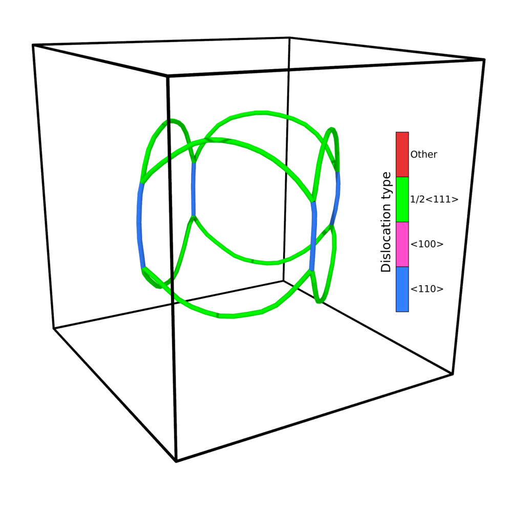
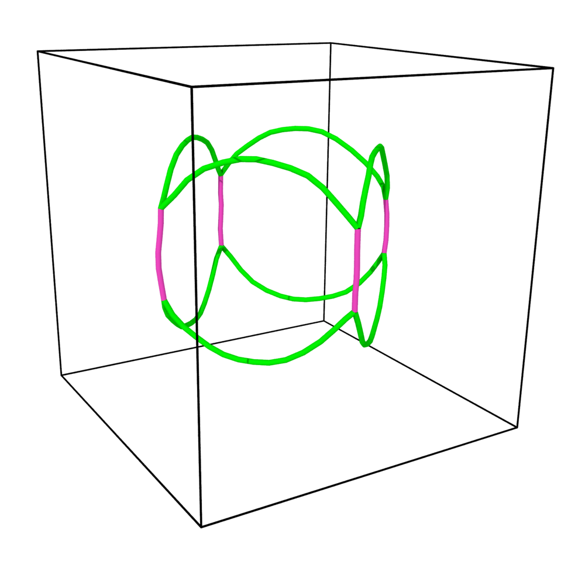
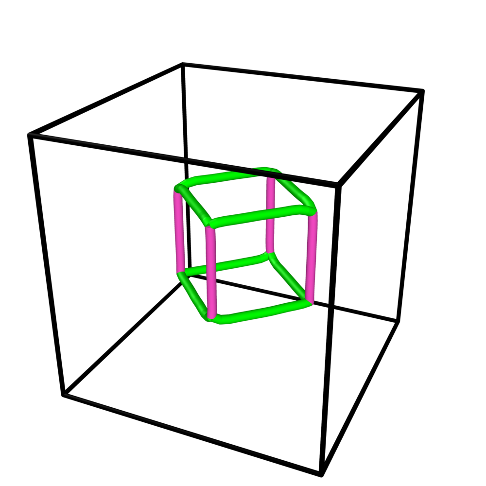

# Quadrupoles

`Examples/generators/make_quadrupole.py` writes quadrupoles of four glide loops on any pair of {110}
planes, with circular, square or rectangular loops. The Burgers vectors are searched so that the
corner reactions form junctions or annihilate. With `--tiles`, many different quadrupoles go into one
sample. Each file comes with a ground-truth sidecar ([Input generators](generators.md#sidecar-namejson-schema-1)).

<div class="grid" markdown>
<figure markdown="span">
  { width="300" }
</figure>
<figure markdown="span">
  { width="300" }
</figure>
</div>
<p align="center"><em>Glissile circular-loop quadrupoles (dislocation lines from DXA). Left: corner
products ⟨110⟩ (blue), no junction. Right: a⟨100⟩ junctions (pink). Green: ½⟨111⟩.</em></p>

## Background

**BCC slip systems.** In BCC metals the primary slip systems are {110}⟨111⟩, with
b = (a0/2)⟨111⟩. The glide condition b · n = 0 leaves 12 systems: 6 planes × 2 directions.

**Why four loops.** Four loops on two intersecting planes meet along the planes'
intersection lines. Depending on the Burgers vectors chosen, the segments that meet there
can react into a junction or annihilate. This gives controlled configurations for studying
these reactions and for checking dislocation-analysis tools.

**Frank's rule.** Two dislocations b₁ and b₂ meeting at a node can lower their elastic energy (∝ b²)
by combining into b₃ = b₁ + b₂ when |b₃|² < |b₁|² + |b₂|². In BCC, two ½⟨111⟩ can give
a⟨100⟩ (|b₃|² = a0² < 3a0²/2, favourable) or a⟨110⟩ (|b₃|² = 2a0² > 3a0²/2, unfavourable).

## `make_quadrupole.py`: any pair of {110} planes

- **Layout.** The four loops lie on the planes n1 · x = ∓s and n2 · x = ±s, the faces of a prism
  along L = n1 × n2.
    - Perpendicular planes (3 pairs) give L = ⟨100⟩ and a square cross-section.
    - All other pairs (12) meet at 60° and give L = ⟨111⟩ and a rhombic cross-section.
- **Square and rectangular loops** are the four faces of a closed tube. Each loop spans exactly its
  face width. Its two sides along L (input key `Side`) coincide with its neighbours' sides
  on the corner lines, so each corner leg carries b_A ± b_B directly.
- **Circular loops:** adjacent loops cross on the four corner lines ∥ L.
- **Loop order:** 1 = face −n1, 2 = +n2, 3 = −n2, 4 = +n1.
- **Burgers vectors are searched.** Each loop gets one of the ½⟨111⟩ of its plane; b ∥ L is excluded,
  since it would be pure screw on both planes.
    - `junction`: every corner product (both lines oriented along +L) is a⟨100⟩, which Frank's rule favours.
    - `annihilation`: opposite faces carry ±b, and every corner product is a⟨110⟩ (no junction).
    - Every {110} pair has solutions: at 90°, 32 junction and 8 annihilation assignments; at 60°,
      2 of each (a global sign flip). `--list` prints them.
- **Size, square or rectangular.** `--d` fixes the face half-width w. `Loopon_size` is tuned close
  to `--loopon-size` so that w = (k + ½) `Loopon_size`, and the half-lengths are written as
  (k + ½) `Loopon_size`. The loop edge then lies exactly on the corner line with both methods: it is
  the contour itself with `Method: line`, and the loopon tile edge with `Method: loopons`. Square:
  half-length along L = w. Rectangle: `--half-m` along L (default 14/11 w), rounded to the grid.
- **Size, circular.** Without `--radius`, the circle gets the smallest radius (rounded up to 0.1 Å)
  whose chords on every corner line overlap by `--overlap` (20 Å). An explicit radius is checked,
  and it is rejected if two neighbours do not cross. Below 5 Å of overlap the script warns:
  near-tangent loops are known to give DXA dangling ends.
- `--d` is the distance from the prism axis to each loop plane. The default is 7.5√2 a0, rounded down
  to a mid-plane: 14.5 d₁₁₀ = 33.86 Å. The YAML header lists the corner products.

```bash
python3 make_quadrupole.py                                            # junction, (110)/(-110), circles
python3 make_quadrupole.py --mode annihilation --shape square
python3 make_quadrupole.py --planes 1 1 0 0 1 1 --shape rectangular   # 60°, <111> corner lines
python3 make_quadrupole.py --all-pairs --shape square --outdir db/    # 15 plane pairs
python3 make_quadrupole.py --shape rectangular --half-m 60            # 60 Å half-length along L
```

<figure markdown="span">
  { width="320" }
  <figcaption>Four square loops sharing their sides: ½⟨111⟩ ends (green), a⟨100⟩ junctions (pink).</figcaption>
</figure>

### Several quadrupoles in one sample (`--tiles`)

`--tiles NX NY NZ` writes NX · NY · NZ quadrupoles into **one** input file, one per cubic tile of
a regular grid, with a single JSON sidecar.

The tiles can differ: each tile takes a (plane pair, mode) combination from a pool:

| Option | Pool |
|---|---|
| `--tile-pairs planes` (default) | the `--planes` pair |
| `--tile-pairs all` | the 15 {110} pairs |
| `--tile-pairs perpendicular` | the 3 pairs at 90° (L = ⟨100⟩, square cross-section) |
| `--tile-pairs oblique` | the 12 pairs at 60° (L = ⟨111⟩, rhombic cross-section) |
| `--mode junction` / `annihilation` / `mixed` | one mode, or both (`mixed`, tiled mode only) |

- `--order cycle` (default) gives the combinations to the tiles in turn, each with the preferred
  Burgers assignment. The sample is deterministic.
- `--order random` draws a combination **and** one of its valid Burgers assignments for each tile.
  `--seed` (default 0) sets the draw.
- `--noise A` shifts each tile rigidly by a random vector: gaussian with standard deviation A,
  cut at 2A, or uniform in ±A (`--noise-type`), on the axes in `--noise-axes`. Every component is
  rounded to a whole a0. Since that is a lattice translation, every loop plane stays on its
  mid-plane and nothing is moved by DISCO.
- `--tile-cells T` sets the tile edge. It must be **even**, so that the tile centres are lattice
  vectors too. The default is the smallest even cube that holds every tile's quadrupole with a
  12 a0 margin, enlarged by the largest possible shift. Every loop must stay at least 2 a0 inside
  its tile, so loops of two tiles never touch. The box is (T · NX) × (T · NY) × (T · NZ) cells.
- Square and rectangular tubes tune `Loopon_size` to their face width, and a sample has a single
  `Loopon_size`. Their tiles must therefore all have the same plane angle: use
  `--tile-pairs perpendicular` or `oblique`. Mixing angles is refused. Circles have no such limit.
- The crossing (circles) or shared-side (tubes) checks of a single quadrupole are run on every tile.

```bash
python3 make_quadrupole.py --tiles 2 2 1                               # 4 identical junction quadrupoles
python3 make_quadrupole.py --tiles 3 3 3 --tile-pairs all --mode mixed \
    --order random --seed 1 --noise 5                                  # 27 random quadrupoles, 108 loops
python3 make_quadrupole.py --tiles 2 2 2 --shape square \
    --tile-pairs perpendicular --mode mixed                            # 8 tubes, junction and annihilation
```

The YAML header lists every tile: its loops, planes, prism axis and Burgers vectors. The
sidecar's `expected.tiles[]` gives the same per tile, plus its centre and shift and the four corner
reactions, with loops numbered across the whole file (tile t holds loops 4t − 3 … 4t).
`expected.frank_favourable_corners` counts the a⟨100⟩ junction corners of the sample.

## References

- J. P. Hirth and J. Lothe, *Theory of Dislocations*, 2nd ed., Wiley (1982).
