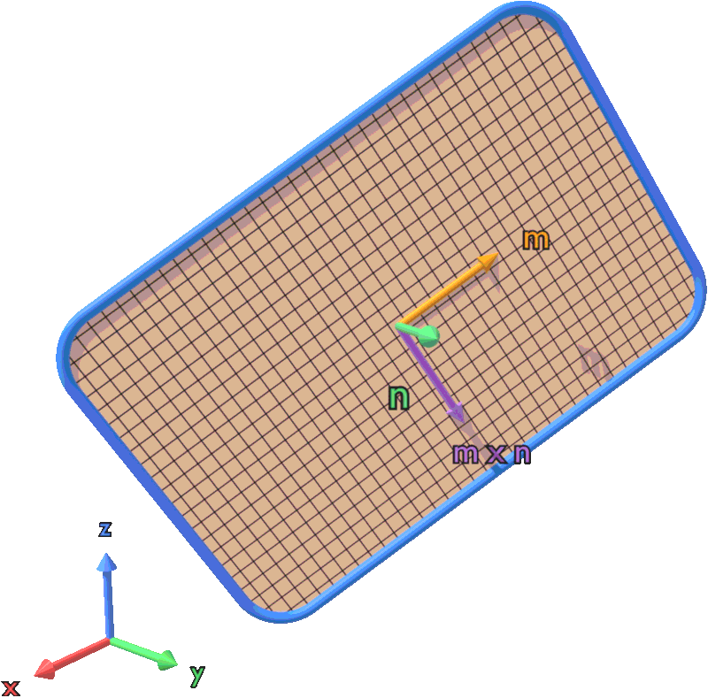

# Theory

This page describes how DISCO builds a sample: the displacement field of the loops, where the cut
of each loop is placed, how matter is added or removed, and how oriented crystals, polycrystals
and twins are handled. Notation and signs are those of [Conventions](conventions.md).

## Problem

A sample is a perfect crystal (cubic, oriented, or polycrystalline) in a periodic orthorhombic box,
plus a set of planar dislocation loops. Each loop is a Volterra dislocation: a flat cut S bounded by
its contour C, across which the material is displaced by −**b**. DISCO moves every atom by the sum of
the displacements of all loops, computed in isotropic linear elasticity (ν = 0.35), and sums over the
27 periodic images of each loop (the box and its 26 neighbours). Atoms are then wrapped back into the box.

Two methods compute the field of a loop. Both give the same field: the line integral exactly, the
loopon sum in the limit of a fine grid.

| `Method` | Field | Cost per atom and image |
|---|---|---|
| `line` (default) | closed-form line integral along C | ∝ number of straight segments |
| `loopons` | sum over infinitesimal loops tiling S (Kroupa, 1966) | ∝ number of loopons |

## Line integral (`Method: line`)

For a cut S bounded by a contour C, Stokes' theorem turns the surface integral of the Kroupa field
(below) into a solid-angle term and line integrals along C (the Burgers / de Wit form,
Hirth & Lothe ch. 4):

$$
\mathbf u(\mathbf x) = \frac{\mathbf b\,\Omega(\mathbf x)}{4\pi}
+ \sum_{\text{segments}} \left[ \left(c_3 - \frac{1}{4\pi}\right) J_0\,\mathbf w
- c_3\,(\mathbf d\cdot\mathbf w)\,(K_0\,\mathbf d + K_1\,\mathbf t) \right],
\qquad c_3 = \frac{1}{8\pi(1-\nu)}
$$

- Ω is the solid angle subtended by S, positive on the side n̂ points to. It is the sum, over a fan
  of triangles from the loop centre, of the Van Oosterom–Strackee formula. It jumps by 4π across S,
  which gives the displacement jump u⁺ − u⁻ = −**b** exactly.
- For a straight segment A → B with unit tangent **t**, **w** = **b** × **t**. With R(s) = **d** + s**t**
  (R = x′ − x, **d** ⟂ **t**) and s running from s_A to s_B,
  J₀ = ∫ds/R = ln[(R_B + s_B)/(R_A + s_A)], K₀ = ∫ds/R³ = [s/(d²R)] and K₁ = ∫s ds/R³ = [−1/R].
  J₀ and K₀ are evaluated in cancellation-free forms.
- C runs counter-clockwise about **n**. The signs of the three terms and this orientation were fixed
  by comparison with a direct quadrature of the Kroupa kernel over S: of the 16 sign combinations,
  only this one agrees (to 2 × 10⁻¹⁰ Å); see [Validation](validation.md#analytic-unit-tests).
- The field is singular on C itself, but the cut lies on a mid-plane between atomic planes
  ([Cut placement](#cut-placement)), so no atom is closer to C than d/2.
- Curved contours (circles, rounded corners) are cut into chords of sagitta ≤ `Segment_tolerance`
  (default 0.01 Å). The closed form is exact for that polygon (`Code/barnett.hpp`, `loop::polyline`).
  With ε = 0.01 Å a circle of radius 30 Å has 115–135 chords and a rounded hexagon about 50 segments.

## Loopon sum (`Method: loopons`)

A loop bounding a planar surface S produces the same displacement field as the infinitesimal loops
tiling S. DISCO tiles S with a regular grid of step `Loopon_size` centred on the loop centre: square
for circles, rectangles and polygons, oblique (along `Dir_1`, `Dir_2`) for parallelograms. Every
grid node inside C is a *loopon* carrying the area dS of one grid cell:
dS = `Loopon_size`² (square grid) or `Loopon_size`² sin(Dir_1, Dir_2) (oblique grid). Nodes exactly on
C are excluded for a circle and included for the other shapes. The swept area N_loopons · dS tends to
the contour area as `Loopon_size` → 0; for polygons the log prints both.

{ width="320" align="right" }

The displacement at an atom due to one loopon, with **ρ** = **r**_atom − **r**_loopon and ρ = |**ρ**|,
is the field of an infinitesimal loop (Kroupa, 1966):

$$
u_i = -\frac{|b|\, dS}{8\pi(1-\nu)}\,\frac{1}{\rho^2}
\left[\frac{1-2\nu}{\rho}\left(\hat n_i\,(\hat{\mathbf m}\cdot\boldsymbol\rho) + \hat m_i\,(\hat{\mathbf n}\cdot\boldsymbol\rho) - \rho_i\,(\hat{\mathbf m}\cdot\hat{\mathbf n})\right)
+ \frac{3\,\rho_i\,(\hat{\mathbf m}\cdot\boldsymbol\rho)(\hat{\mathbf n}\cdot\boldsymbol\rho)}{\rho^3}\right]
$$

with m̂ and n̂ the unit Burgers direction and plane normal. An atom closer than 10⁻¹⁰ Å to a loopon
gets no contribution from it. The contour only decides which grid nodes are loopons, so every shape
goes through the same kernel.

The grid resolves the contour only to about `Loopon_size`: the error falls with the step (rms
9 × 10⁻³ Å at 0.4 a0, 2.6 × 10⁻⁴ Å at 0.05 a0 on a glide quadrupole, compared with `line`) and is
largest at the cores. The effective extent of a straight side is (k + ½) `Loopon_size`, halfway
between two grid rows; the generators use this to make shared sides coincide with both methods.
An atom–segment pair costs about ten atom–loopon pairs, but a loop has far fewer segments than
loopons (48 against 23 579 for a rounded hexagon of circumradius 30 Å at a 0.31 Å step), so `line`
is both exact and faster.

## Cut placement

The cut must lie between two atomic planes, not on one. DISCO moves the requested centre along n̂
onto the nearest **mid-plane** between dense planes of the (hkl) = **n** family, without changing its
in-plane position (`snapToMidPlane`, `Code/loop.cpp`). The plane spacing is

- BCC: d = a0/|**n**| if h + k + l is even, a0/(2|**n**|) otherwise;
- FCC: d = a0/|**n**| if h, k, l are all odd, a0/(2|**n**|) otherwise.

This gives, in BCC, d = 2.335 Å for {110}, 1.348 Å for {112}, 0.883 Å for {123} (a0 = 3.3024 Å), and in
FCC d = 2.087 Å for {111}, 1.278 Å for {110}, 1.808 Å for {100} (a0 = 3.615 Å). A centre exactly on an
atomic plane goes to the mid-plane on the +n side. In an oriented crystal or a grain, the planes are
those of that crystal's lattice.

## Loops with b · n ≠ 0: adding or removing matter

For a prismatic or mixed loop, the Volterra cut opens a gap, or makes its lips overlap, by |**b** · n̂|.
A displacement field cannot create or destroy matter: without atoms added or removed the sample is
only a strained perfect crystal, and it relaxes back. Following Atomsk's procedure
(`opt_disloc.f90`, loop case), `Code/prismatic.cpp` (with `Matter: auto`):

1. **Slab selection** (host, on the perfect lattice). The slab is bounded by the two mid-planes on
   either side of the cut, |**b** · n̂| = k d apart (k is an integer because **b** is a lattice
   vector), and by the loop contour, with the same inside test as the field. It holds 3 {111} planes
   for ½⟨111⟩ on (111), 1 {110} plane for ½⟨111⟩ on {110}, 2 {100} planes for a⟨100⟩ on (100).
2. **Vacancy loop** (**m** · **n** > 0): the slab atoms are deleted.
3. **Field** (GPU or CPU): one call for all loops, glide and prismatic alike.
4. **Interstitial loop** (**m** · **n** < 0): each slab atom is duplicated. The copy gets the
   displacement already computed for its source atom plus sign(s) **b**, so it lands on the other
   lip of the cut. Since **b** is a lattice translation, originals and copies fill the gap with
   perfect crystal. No kernel is run for the copies.

The number of atoms added or removed is close to ρ A |**b** · n̂| (it differs by the atoms cut by the
contour); the log prints both. The box is not deformed, so the sample starts with a volume change
±A |**b** · n̂| and must be relaxed at constant pressure. With `Method: loopons`, the atoms kept next
to the cut of an interstitial loop are only d/2 from the loopon plane, which needs
`Loopon_size` ≤ 0.35 d (DISCO warns otherwise); `Method: line` has no such limit.

A loop built this way can glide along **b** on its glide prism but cannot vanish without climb, so
it survives thermal MD. In contrast, a dipole of two prismatic loops built from shear loops only
(`make_prismatic_dipoles.py`) holds no extra matter and annihilates by glide.

### Faulted loops (FCC)

When **b** is not a lattice translation, the cut leaves a stacking fault. Two cases are recognised.

- **Frank loops** (**b** = a0/3⟨111⟩, sessile) add or remove one {111} layer. An inserted layer
  cannot simply repeat its neighbour, as the copy at ±**b** of a perfect loop does: that would stack it
  straight over its source (AA). Each copy is therefore also shifted in the plane by the Shockley
  vector that puts it on the third stacking position (…A **C** B C…, extrinsic fault). A removed layer
  leaves an intrinsic fault.
- **Shockley loops** (**b** = a0/6⟨112⟩, glide). Across the cut the +n side moves by −**b**, and only one
  sense of **b** turns the layer above the cut into the next stacking position (intrinsic fault). The
  other sense puts it straight over the layer below (AA), which is not a stable fault: CNA shows no
  HCP layer and DXA finds no loop. DISCO tests whether d n̂ − **b** is a lattice translation and warns
  for the wrong sense ([Conventions](conventions.md#loop-character)).

Fractional **m** must be written as exact fractions (`2/3`): a decimal is not accurate enough for the
plane-count check of the slab. Perfect FCC loops dissociate into Shockley partials on relaxation.

## Oriented crystals, polycrystals and twins

### Oriented crystal

`Orientation: {X, Y, Z}` gives the crystal directions of the box axes (orthogonal, right-handed). Each
box length is a whole number of **lattice periods** along its direction [uvw] (reduced), the shortest
lattice translation along it: FCC a0/2 |uvw| if u + v + w is even, a0 |uvw| otherwise; BCC a0/2 |uvw|
if u, v, w are all odd, a0 |uvw| otherwise. The box is then exactly periodic. Crystallographic
vectors of the loops are given in the crystal frame and rotated by R; `Center` stays in the box frame.
The mid-plane snap, the matter slab, the Frank and Shockley rules and the field work unchanged.

### Polycrystal

A periodic Voronoi polycrystal: each grain has a seed and an orientation, and each site belongs to the
grain of its nearest seed (periodic minimum image).

- **Orientations** are uniform over all rotations (random unit quaternions), or given as
  `Orientation` or Bunge `Euler` angles. Each grain's lattice has a site on its seed.
- **Filling.** A grain's periodic Voronoi cell lies within ± L/2 of its seed on every axis, so each
  grain is filled from its own lattice in that region, unwrapped around the seed, and wrapped back
  into the box. A grain that crosses a box face is one continuous crystal, with no seam at the
  periodic boundary. Ties between two seeds follow a fixed rule, so no site is kept twice; one grain
  with a commensurate orientation reproduces the oriented crystal exactly.
- **Grain boundaries.** Every pair closer than `GB_min_distance` × NN distance (FCC a0/√2,
  BCC a0√3/2) loses the atom of the higher grain. A perfect crystal has no such pair, so only GB atoms
  are affected (a few % for ~10 nm grains). The GBs are geometric, not relaxed.
- **Random numbers** are platform independent (a portable mt19937_64): one `Seed`, one sample.

**Loops in grains.** A loop with `Grain: k` is given in grain k's crystal frame, snapped to grain k's
planes, and its cut must stay in grain k, where **b** is a lattice vector. If the contour leaves the
grain, it is **clipped** by the grain's Voronoi faces: the loop keeps the part of its contour inside
the grain, and the clipped edges lie in the GBs (segments absorbed by the boundary). A loop larger than
its grain spans the grain's whole cross-section (a Shockley loop becomes a stacking fault from GB to GB).
A clipped loop is rebuilt as a polygon. A loop whose plane misses its grain, or keeps a sliver smaller
than 4 |b|², is **skipped**: its whole field, rotations included, comes from its dislocation lines, and an
empty contour has none. The field of every loop is applied to every atom: with isotropic elasticity
the field does not depend on the crystal orientation, so the polycrystal is elastically homogeneous.
Atoms added or removed are taken in the loop's grain only.

### Twin lamellae

A coherent twin is the mirror image of the parent across a twin plane through atoms ({111} FCC,
{112} BCC).

- The first twin boundary (TB) is moved onto the nearest atomic plane. The atoms of the next m − 1
  layers are moved, each layer by one in-plane vector (at most a0/√6 in FCC), onto the mirror lattice.
  No atom is added or removed and there is no elastic field.
- The second TB (layer m) is also a coherent mirror only if the two mirrors compose to a lattice
  translation: m must be a multiple of 3 (FCC {111} and BCC {112}). The thickness is snapped
  accordingly (at least 3 planes).
- A lamella spans its grain and ends at the GBs; in a single crystal it spans the periodic box, so the
  twin plane must be normal to a box axis. Lamellae of one grain are parallel and separated by at
  least one matrix layer.
- The twin frame is the parent turned by 180° about n̂ ([Conventions](conventions.md#frames)). A loop
  whose centre lies in a lamella is read and snapped in the twin frame. Every loop of a twinned crystal
  is clipped at the TBs like at the GBs, and its matter slab only takes atoms of its own region.
- BCC: the pure-mirror {112} TB (reflection twin) puts atoms of layers ±1 at 2d = 0.816 a0; relaxation
  turns it into the isosceles TB (shift a0/12 ⟨111⟩).

## Box deformation

!!! warning "Not applied"
    The routine below is implemented and unit-tested (`make test`), but the driver does not apply it:
    in `Code/main.cpp` the call to `computeU` is commented out and U = I. The box is the undeformed
    orthorhombic box, and the log prints `U − I = 0`.

Inserting a shear loop of area A displaces the material above its plane by **b** relative to the
material below. In a periodic box this corresponds to a homogeneous plastic distortion

$$
\beta_{ij} = \frac{1}{V}\sum_k b_i^{(k)}\, n_j^{(k)}\, A^{(k)} .
$$

Its symmetric part is the plastic strain and its antisymmetric part the plastic lattice rotation.
`Code/loop_deform.cpp` takes F = I + β, computes the polar decomposition F = R U from the
eigendecomposition of C = Fᵀ F = V diag(λ) Vᵀ (U = V diag(√λ) Vᵀ), and applies only the stretch:
H′ = U H for the box matrix and r′ = U r for the atoms. For pure shear loops det U = 1; the code warns
if the volume changes by more than 0.01 %.

## References

- F. Kroupa, "Dislocation dipoles and dislocation loops", *J. Phys. Colloques* **27** (1966) C3-154.
- J. P. Hirth and J. Lothe, *Theory of Dislocations*, 2nd ed., Wiley (1982).
- D. M. Barnett, "The displacement field of a triangular dislocation loop", *Phil. Mag. A* **51** (1985) 383.
- A. Van Oosterom and J. Strackee, "The solid angle of a plane triangle", *IEEE Trans. Biomed. Eng.*
  **30** (1983) 125.
- P. Hirel, "Atomsk: A tool for manipulating and converting atomic data files", *Comput. Phys.
  Commun.* **197** (2015) 212.
- E. B. Tadmor and R. E. Miller, *Modeling Materials*, Cambridge University Press (2011).
